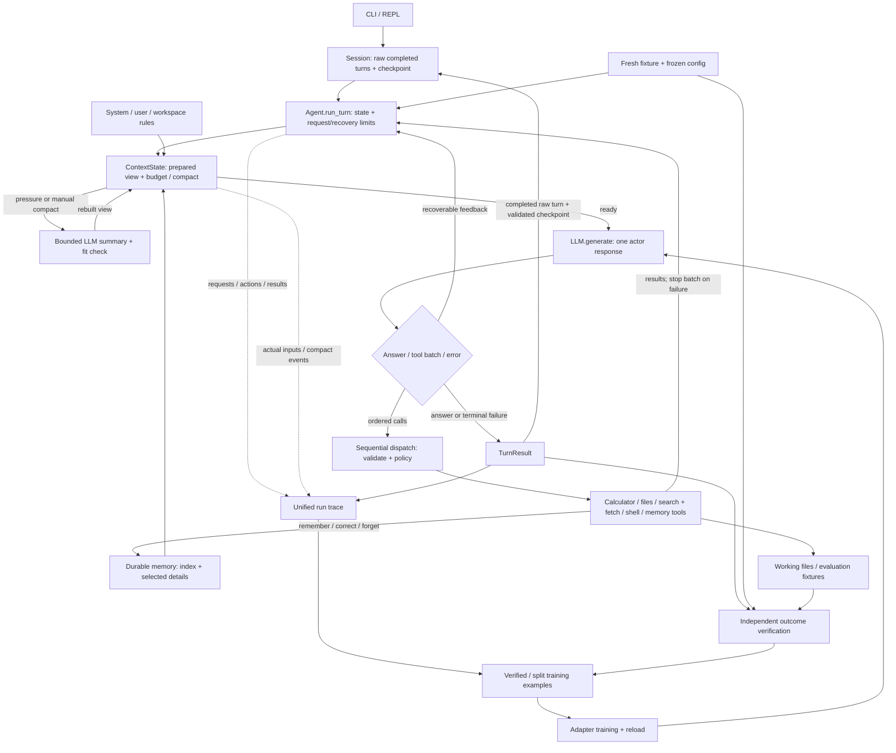

# Build a tiny agent: a two-week sprint

Updated September 21, 2026. Sprint: **September 13–26**; earlier experiments are carried-in work.
This is the implementation scope. [REPORT_ANALYSIS.md](REPORT_ANALYSIS.md) retains the broader learning rationale.

## The finished project

Build a tiny Python agent to learn, through incremental development, how agent loops,
state/result tracing, error recovery, context compaction, and memory change its behavior.
The deliverable has two parts:

- **A working local agent:** sustained CLI conversations, completed-turn session replay,
  local file reads/edits/writes and execution of local scripts, sequential dependent
  tool calls, traceable actions/results, and bounded recovery from common errors.
  Long conversations can compact and continue; explicitly saved knowledge can survive a new session.
- **A post-training experiment:** adapt a trainable base checkpoint with an actual weight
  update, reload it, and use a reproducible benchmark to test whether agent capability improves.
  Aim for gains in completion, recovery, and stopping; report failures and regressions honestly.
  Better prompts or memory alone do not count as post-training.

Use disposable text/JSON workspaces as a small test environment. A representative demo:
inspect files → update a requested value → run a local script/check → use its feedback →
report the observed result → continue the conversation after compaction/restart.
This demonstrates mechanisms; it does not require a general assistant or a vertical-domain product.

**Outside this sprint:** a production coding workflow with edit review/revert guarantees;
local/WeChat/cloud deployment; streaming; asynchronous or concurrent calls; third-party
skills/MCP integration; multi-agent collaboration; background jobs. Stages 4C and 5–7
remain optional future learning branches. Basic synchronous web fetch belongs to Stage 2.

Protect time for both runtime and training: target the small Stages 2–4 core first,
then benchmark/data/training in the second week. These are planning checkpoints, not
completion claims. If work overruns, reduce mechanism breadth and label smaller experiments
as pilots; mark missing required outcomes incomplete instead of silently extending the sprint.

### Implementation order and concrete outputs

| Order | Stage / status | Concrete output |
|---|---|---|
| Carried in | **0.5 — complete** | One user request → model/tool/result loop, validated contracts and error feedback |
| Completed | **1 — complete** | Multiple user turns, persisted Session history, structured per-turn state and traces |
| Completed | **2 — implementation complete** | General filesystem/shell/search/fetch; restricted 2B baseline 8/17 → 12/17 |
| Completed | **3 — implementation complete** | Context budgeting, automatic/manual compact, rule reload at the boundary, versioned checkpoints and restart replay; real-model evidence for 3B items 2-4 and 3C still outstanding |
| Deferred past 11 | **4A–4B — deferred (decided September 22, 2026)** | Bounded durable memory, search/read, correction/forget, fresh-session recall |
| Completed | **8 — complete: frozen benchmark and protocol, Qwen3-4B control baseline (test mean pass@1 0.667)** | Resettable benchmark, isolated splits, measured baseline, frozen harness |
| Completed | **9 — complete: test mean pass@1 0.419 (base) → 0.724 (teacher-v3), 0.774 (mix)** | LoRA SFT of the 4B student on train tasks and public data, chosen on val, reported once on test and an external benchmark |
| Later experiment | **10 — draft, conditional** | 2–3 rounds of expert iteration (weak-RSI question); GRPO pilot as a second arm from M1 if M1's samples meet its go conditions |
| Delivery | **11 — draft, required outcome** | Held-out paired results and reproducible demo; val-only recipe search optional |
| Future branches | **4C / 5 / 6 / 7 — optional** | Dream / skills and MCP / jobs / child agent and planning |

Numbering follows the scratch notes: old Stage 1.1 is now Stage 1; old 1.2 tools move
into Stage 2, alongside its original behavioral evaluation. The original Stage 2 session
plumbing is already complete in Stage 1. Historical evidence filenames keep their old numbers.

### Coding rules for me and AI

- Use ordinary functions/dataclasses and the standard library where practical.
- Implement and explain the loop, context, tracing, tool boundaries, memory, recovery,
  and training-data logic myself. Use AI for review, fixtures, boilerplate, and debugging.
- Accept ordered tool-call batches; execute sequentially, stop the batch on failure, and
  wait for observations before choosing result-dependent arguments. Keep the binary calculator.
  Add modules only when needed; no framework rewrite, event bus, provider catalogue, or UI project.
- Aim for roughly 1,500–2,000 runtime lines; review scope around 2,500. Count tests and
  eval/training separately. This is a design alarm, not a reason to compress readable code.
- Each stage leaves a small demo, a deliberate failure, and evidence of what changed.
  Use focused tests for state and side effects, real-model runs for capability; keep those claims separate.

### Core code size audit

Audit date: September 17, 2026. Count committed **core Python only**: top-level runtime
modules and `tools/`, including the real `agent.py` REPL entry point, argument validation,
response parsing, tracing and session persistence. Exclude `prompts/`, tests, evals,
verification modules, examples, docs, dependencies, generated outputs and untracked stubs.
Non-agent `__main__` demo blocks are also excluded (currently the demo in `llm.py`).
The unused, untracked `memory.py` placeholder is not part of Stage 3A.

**Code lines** are physical lines containing Python syntax tokens, excluding blank lines,
comments and docstrings; multiline literals used by runtime count as code. **Physical lines**
include blanks/comments/docstrings in the same selected source, but exclude demo blocks.
File counts below exclude empty package initializers. These are size measures, not a measure
of capability or quality. The earlier 1,500–2,000 / 2,500 scope alarm refers to physical lines;
do not switch it to the smaller code-only number to hide growth.

Only snapshots with an explicit stage-completion marker are used below. `ebd249d` says
“Complete Stage 2” in its commit subject. `24f2608` and `b3dfab0` contain a `STAGE.md` marking
Stage 2 implementation complete, with the latter labeled “before stage 3” in its subject.
Stage 0.5 (`e282138`) and old Stage 1.1 (`e248ca2`, now Stage 1) have named baseline commits,
but no separate, unambiguous completion marker under today's scope: the former still records
an unresolved parser test and the latter says “initial session management.” Both are explicitly
marked complete retrospectively by `ebd249d`, whose source already includes Stage 2. Do not
invent separate completion counts from that combined tree or treat intermediate baselines
as completed stages. Intermediate experiments and stash commits are excluded.

| Completed checkpoint | Git reference | Nonempty core files | Code lines | Physical lines | Code change from previous row |
|---|---|---:|---:|---:|---:|
| Stage 2, initial restricted tools + behavioral evaluation | `ebd249d` | 11 | 1,285 | 1,515 | — |
| Stage 2, general tools + narrated batches | `24f2608` | 12 | 1,747 | 2,039 | +462 |
| Stage 2 handoff, structural refactor before Stage 3 | `b3dfab0` | 13 | 1,759 | 2,073 | +12 |
| Stage 3A complete: context, instructions, measurement, fit gate | Commit containing this audit: `Complete Stage 3A context budgeting` | 14 | **1,940** | **2,296** | **+181 (+10.3%)** |
| Stage 3 complete: compaction, rule reload, checkpoints, restart replay | Commit containing this audit | 15 | **2,254** | **2,800** | **+314 (+16.2%)** |

Stage 3B item 1 and the September 20 refactor brought the tree to 2,584 physical lines at
`d7f3887`; Stage 3B items 2-4 and Stage 3C added **216 more (+8.4%)**, reaching 2,800 physical
/ 2,254 code. Source fingerprint
`ece7ac5b6790923d05f59bb3c553cfe00e3fa99eca695b1a0ef7a312de8e8e4f`. That is nearly double the
roughly 120 lines the work was estimated at; the excess is Google-style docstrings on the new
public surface rather than new branching. The 2,500-line alarm was answered by the
design-boundary review in [context-memory.md](context-memory.md#design-boundary-review-2584-physical-lines),
which revised the alarm to **3,000 physical lines** and split no modules.

Stage 3A added **223 physical lines (+10.8%)** over its direct parent. Its code growth is:

| Core file | Before 3A | After 3A | Code-line increase |
|---|---:|---:|---:|
| `context.py` | 0 | 96 | +96 |
| `agent.py` | 242 | 298 | +56 |
| `llm.py` | 223 | 248 | +25 |
| `trace.py` | 73 | 76 | +3 |
| `config.py` | 22 | 23 | +1 |
| Other core modules | 1,199 | 1,199 | 0 |

Tools account for **1,019 / 1,940 code lines (52.5%)**; the loop/model/context/session and
support modules account for the other 921. The largest earlier jump was general tools and
batches, not context management. At 2,296 physical lines we are above the original target and
204 lines below the scope-review alarm. Before Stage 3B grows, review the design boundary;
do not compress readable code merely to stay under it.

Reproduce from the repository root with the dependency-free audit utility
[`evals/core_lines.py`](../evals/core_lines.py), which is itself excluded from the count:

```sh
python -m agent_from_scratch.evals.core_lines ebd249d 24f2608 b3dfab0 HEAD
# Before a future completion commit, audit exactly the staged source:
python -m agent_from_scratch.evals.core_lines INDEX
```

Use `--git /Library/Developer/CommandLineTools/usr/bin/git` on this Mac if the normal Git
launcher is unavailable. Output includes per-file counts and a SHA-256 of sorted source
paths/contents. Stage 3A source fingerprint:
`70e426cf585e43211a32cb4ffe7ce95702a194092942b6f08ef152a02f07ba0f`.
At each explicitly completed stage, append one row using its committed snapshot; preserve
older rows, replace this row's self-reference with its hash, and explain any scope-rule change.
Review newly added root/tool modules for verification-only or demo code before counting them.

## Stage 0.5 — one request with an agent loop · complete

- [x] Local Qwen/llama.cpp inference, response parsing, tool dispatch, and calculator.
  One user request can contain several model → tool → observation iterations before a final answer.
- [x] Validate response structure and tool arguments before execution; return parse/tool
  errors to the model as feedback, with a bounded request count.
- [x] Extract native/Qwen call batches with surrounding narration; preserve quoted examples
  as text. Validate all call JSON/shapes before execution; cap at 8 calls/response and 40 attempts/turn.
- [x] Trace each call/result, including skipped calls after failure, interruption or budget
  exhaustion. The later batch support supersedes the historical single-call notes below.
- [x] Show complete assistant progress messages in the REPL before the associated calls;
  keep model generation non-streaming.
- [x] Model the scratch-note concepts with the current `LLMResponse`, `ResponseError`,
  `ToolResult`/`ToolErrorCode`, and `TurnResult`; no renaming to `ResponseResult`/`ToolError` is required.

**Capability gained:** tool use within one request. Cross-request conversation belongs to Stage 1.
Evidence: [baseline notes](day01_stage0.5.md).

### My Takeaways (AI is NOT ALLOWED to edit)

- Load only the required quantized files, for example
  `hf download Qwen/Qwen2.5-7B-Instruct-GGUF --include "qwen2.5-7b-instruct-q4_k_m-*.gguf"`.
  The previous note recorded roughly 4.68 GB; treat that as a historical observation.
- Model loading, reuse of a loaded model, and prefix/KV-cache reuse are different.
  A `prefix-match hit` log concerns inference reuse, not cross-turn conversation
  memory. `verbose=False` is already present for llama.cpp logging.
- SOLVE ONE PROBLEM AT A TIME, FIND THE GAP IS THE KEY. Predict where messages append and why a
  loop exits before adding another mechanism.
- A **tool** is callable code with an argument/result contract. A **skill** is
  reusable instructions plus optional resources/scripts; it can guide several
  tools, but is not itself necessarily executable code. Stage 5 implements discovery
  summaries and loading separately from dispatch.
- Keep Qwen parsing a compatibility fallback; do not detect calls from a loose
  substring, fabricate a tool result for an unparsed call, or add JSON repair machinery.
- A list of tool calls, an arithmetic-expression tool, and concurrent tool execution
  remain optional later comparisons. If an expression tool is ever added, use a
  restricted arithmetic parser, never unrestricted `eval`.

### My Scratch Notes (AI is NOT ALLOWED to edit)
1. Stage 0.5: one-turn with llm calling and basic tool calling enabled, e.g. single user_input -> llm.generate() -> tool call -> result per turn. Guard with tool schema validation, reponse validation and parsing, error capture and ingested back to model. You should has some data modelling designed for `ToolResult`, `ToolError`, `ResponseResult`, `ResponseError` and `TurnResult`.
2. Stage 1: 
- From one-turn to multi-turn interactions. This is where the `Session` is first developed and conversation is preserved for history. Record such as messages, state (stop_reason, error etc.) should be stored in a strucuted way per turn. 

## Stage 1 — multi-turn sessions and observable execution · complete

Read: book Chapters 1 and 3; Appendix A.1/A.5/A.8. Nanobot: [runner][nb-loop] and
[session history][nb-session] separate the execution lifecycle from conversation replay.
Our `SessionStore` keeps that distinction without Nanobot's channels, hooks, or streaming.

- [x] Preserve conversation across user turns; support `/new`, `/reset`, `/session <id>`.
  `run_turn` receives history explicitly; the REPL loads completed turns from disk.
- [x] Keep structured **session → run → model request/tool result** records: IDs,
  ordered messages, raw responses, errors, stop reason, settings, elapsed time, and available usage.
  Call IDs join requests to results. Run schema is v3; session schema is v1, with legacy readers.
- [x] Distinguish `final_response`, `max_iterations`, `tool_limit`, `no_progress`, `model_error`,
  and `interrupted`. Parser/tool failures get targeted feedback; three identical consecutive
  failures stop the loop. Backend errors stop cleanly; Ctrl-C retains available run evidence.
- [x] Replay only completed turns. Failed/interrupted runs remain trace evidence;
  independent trace/session write failures do not erase previously saved state.

**Completion boundary:** Stage 1 is complete for this rescope; context management remains
Stage 3. Persistence is single-writer and saved at turn end, without exact mid-turn crash resume.
The foundation checkpoint (a working record, not in the published docs) recorded 82 deterministic tests
and real-model smoke results; those are historical evidence, not tests rerun by this document edit.
A terminal answer still does not prove task success; premature stopping is an observed model gap.

## Stage 2 — file, web, shell tools and the first behavioral baseline · implemented

Read: book Chapters 1/3/4; Appendix A.1/A.3/A.5/A.8. Keep the lifecycle explicit:
**parse → registry/schema validation → execution policy → execute → result/error → next iteration**.
Prompt rules describe expected behavior; runtime enforces paths, allowed operations, and budgets.

### 2A — finish the small tool set · implemented

- [x] Inject a registry per agent; schemas reflect that registry. `tools/files.py` provides
  recursive/paginated `list_files`, line-numbered `read_file`, full/append `write_file`, and
  targeted `edit_file`. Support general local paths, optional confinement, continuation,
  atomic replacement, mode preservation and optional version checks. Read PDF/Office text
  through `file_documents.py`; images expose metadata only. The original confined byte-based
  tools (`evals/legacy_files.py`) served the Stage 2B suite until both were retired after
  Stage 8; they remain in git history at `ce2111a`.
- [x] **`tools/web.py`:** synchronous general HTTP/HTTPS `web_fetch(url, extract_mode?)`
  with compressed responses and main-content or navigation-inclusive HTML text extraction,
  plus `web_search(query, count?)` via `ddgs`. Both return source URLs and retrieval time;
  fetch also reports HTTP status and truncation. Bound time/content and fetch redirects.
  Extraction does not render CSS or JavaScript. Pages/snippets are untrusted evidence.
  An optional host list supports restricted fixtures. Browsers/login remain out of scope.
- [x] **`tools/shell.py`:** synchronous `shell(command, working_dir?)` runs ordinary local
  commands, scripts, pipes and redirects. Return exit code, capped stdout/stderr and
  timeout/interruption status; clean up foreground process groups on timeout/Ctrl-C.
  Keep optional fixed `command_id` mode for the original benchmark and fixture demo.
  General shell uses local user permissions; cwd/file-tool bounds do not sandbox it.
- [x] Make denials and failures visible through `ToolResult` and the same run trace.
  On interruption, record a pending call as interrupted/unknown if no result exists;
  never imply it succeeded or automatically replay its side effects. Keep the REPL usable.

Evidence: the tools checkpoint (a working record, not in the published docs). The initial restricted 2A
implementation had 102 tests; the general-tool follow-up has separate mechanism/live checks.
The fixed 2B suite below remains the historical behavioral baseline.

**Nanobot comparison:** [registry][nb-registry] validates and feeds errors back;
[filesystem][nb-files] separates read/write path resolution; [shell][nb-shell] implements
process cleanup and output limits; [web][nb-web] records extraction/redirect/truncation data.
The September 15 follow-up adopts Nanobot's filesystem, general shell and search/readability approach,
using its underlying libraries with our synchronous `ToolResult`/trace contract.
No async runtime, provider catalogue or interactive approval engine is added.

### 2B — first behavioral baseline · complete

- [x] `evals/run.py` + `verify.py` reuse foundation read-coverage checks. **17 Stage 2B tasks**
  cover dependent inspection, constrained changes, matched recovery, stopping and calculator.
  Rows specify prompt, fixture, tools, budget, verifier, evidence/constraints and split.
- [x] Allocate skeletons before variants; use fresh temporary files and session state per run.
  Fixed Python verifiers inspect artifacts and actual source reads after the ordinary loop ends.
  Recorded web results isolate behavior from network changes; 2A retains live-fetch evidence.
- [x] Save task outcomes, call/error counts, paired recovery, reviewed false completion,
  unintended writes, requests/usage/latency, settings and code/fixture hashes. Missing usage
  stays unknown. Train/test skeletons are reserved; their task sets are not yet generated.

**Evidence:** the 2B checkpoint (a working record, not in the published docs), **118 tests**, 17/17 scripted
solutions; prompt ablations improve **8/17 → 12/17 strict passes**, retaining all original passes.
The full prompt fixes no-op behavior; nested edits, web JSON/recovery and two answer formats
still fail. Two false claims and one unintended-write task remain. The selected prompt trades
fewer side effects than shorter candidates for higher generation cost: 78 → 270 seconds.
Bad arguments/blocked commands and follow-up/reload/reset have scripted regression coverage;
real Stage 2B tasks exercise path denial, fetch failure and timeout. Fake “done” artifacts fail.
Implementation/baseline are complete; reliable autonomous completion remains a measured goal.

**September 16 handoff review:** all **167 deterministic tests pass** in
`transformer-practice` (`python -m unittest discover -s agent_from_scratch/tests -v`).
The **8/17 → 12/17** results above are historical restricted-tool development runs,
predating the general tools, narrated-call parser, batches and later prompt/template changes.
Saved results were checked; no fresh real-model benchmark was run for this review.
Stage 2 is complete at that implementation/baseline boundary, and Stage 3 can begin.
The original handoff count was **2,083 physical Python lines / 15 files** (including two empty
package files). The core-only audit above excludes the 10-line embedded `llm.py` demo,
yielding **2,073 physical lines / 1,759 code lines / 13 nonempty files** at `b3dfab0`.

## Stage 3 — context construction and compaction · required

Read: book Chapters 2/3/5; Appendix A.1/A.2/A.4/A.5. Nanobot:
[context assembly][nb-context], [accepted history versus unsent delta][nb-governance],
and [summary checkpoint][nb-summary]. Apply the mechanisms to our measured window;
the book's token constants and vendor-specific recovery paths are not our configuration.
Design decisions: [tool-result semantics and state ownership](CONTEXT_STATE_DESIGN.md).
Stage 3 is implemented. Each generation receives an independent prepared view whose
prompt tokens and remaining room are checked before generation; compaction is automatic or
manual through one bounded path; and a versioned summary checkpoint lets a restarted session
replay a summary plus its uncovered raw suffix. The REPL gained `/compact` and loads a
checkpoint per turn; other new CLI commands stay deferred, and a future `/status` may expose
usage, reported cache data, session ID and context statistics. Deterministic coverage is
complete; **no local-model diagnostic was run for 3B items 2-4 or 3C** because the September
20 host could not hold the 7B weights. See [context-memory.md](context-memory.md).

### 3A — one prompt path and a visible budget

- [x] Add `context.py`: one builder used **before every generation**, including after tools
  and parser feedback. Explicit instruction/history/current-turn inputs are deep-copied
  into the model-facing view; raw messages retain all exchanges for traces, sessions and
  evaluation. Durable memory and summaries remain future inputs when those features exist.
  Validation: **170 deterministic tests pass**, including deep-copy isolation and fresh
  inputs after parser feedback/tool results, with trace/session replay preserved.
- [x] Organize `prompts/system.md` into purpose, behavior, tools, and reporting rules.
  Load only an explicitly configured user instruction file and workspace-root `AGENTS.md`.
  Use a documented order (system → user rules → workspace rules), source hashes, and caps;
  preserve the runtime contract, and give current user corrections priority over saved preferences.
  Source order aids inspection; it does not itself enforce model compliance. `context.py`
  loads once per turn; compact-boundary reloading waits for Stage 3B. No ancestor crawling
  or imports; the prompt prohibits autonomous rule edits. Defaults are 8 KiB/source and
  16 KiB assembled, with visible setup errors instead of silent omission/truncation.
  **178 deterministic tests pass**; source metadata lives in the existing run settings.
- [x] Count the actual formatted prompt, including schemas/role markers, with the generation
  formatter and tokenizer. Record total prompt tokens, effective backend window, configured
  response reserve and remaining room in request traces; no new CLI command. Custom or
  replaced handlers are explicitly unavailable, with null counts rather than an estimate.
  Detailed component breakdowns and a future `/status` can follow when useful. Stale usage
  and KV-cache hits do not measure the next changed prompt or enlarge the context window.
  **183 deterministic tests pass**. Five local Qwen requests matched reported prompt usage
  exactly; a 12,030-token measurement exposed negative room without attempting generation.
  Evidence and limits: [context measurement](CONTEXT_STATE_DESIGN.md#implemented-next-request-token-measurement).
- [x] Require `prompt + response reserve + margin <= window` before every generation.
  The initial fit check stops with `context_limit`, including when exact measurement or
  a bounded reserve is unavailable. Default margin: 256 tokens. Blocked requests retain
  their budget in the trace but do not count as model calls; completed tool effects/results
  remain intact. No silent truncation of the request, rules, or claimed file coverage.
  **191 deterministic tests pass**. Local Qwen diagnostics compared 2,048/4,096-token
  windows and 256/16,000-character read caps: small output continued, large output blocked
  the next generation, and oversized initial input made zero model calls.
  Evidence: [fit enforcement](CONTEXT_STATE_DESIGN.md#implemented-request-fit-enforcement).
  Stage 3B will add early compaction with bounded tool-exchange headroom and separate
  summarizer input/output budgets; the current margin cannot guarantee arbitrary results fit.

### 3B — compact and continue the same task

- [x] Implement automatic compact and a callable manual compact path sharing one
  implementation and `prompts/compact.md`. Summarize goal, constraints, observed progress,
  errors/corrections, and next steps; keep instructions, current request, recent complete
  tool pairs, and every observation not yet sent to the actor. Track that last-sent boundary
  separately. `Compactor.attempt()` in `compact.py` is shared by automatic recovery and
  `run_turn(..., compact=True)`; it returns `CompactOutcome` so the loop can distinguish a
  spent failed attempt from a free refusal without inspecting compaction state.
  Retain two recent tool batches and the unsent raw suffix; one bounded summary call per
  attempt, at most four per run, charged to the existing request limit. Publish only a
  smaller fitting view; raw evidence/session deltas stay unchanged. **204 deterministic
  tests pass**. Real-model retained/lost facts and scope limits: [compact evidence](context-memory.md).
  The REPL now reaches the manual path as `/compact`, which marks the next request rather
  than acting alone: compaction runs inside a turn against that turn's own view, so there is
  no earlier point at which it can take effect. It is deliberately a user command and not a
  model-facing tool, which would run one request too late to relieve the pressure it answers.
  Trace records renamed `ModelRequest.context` to `budget` at `schema_version` 5; records at
  4 and earlier carry the old key, which matters for the 3C eval-export item below.
  September 18 core after the compaction refactor: **2,582 physical / 2,139 code lines**
  across 15 nonempty core files (+109 physical / +45 code over `eef064a`), excluding the
  untracked memory stub. Source fingerprint
  `0dd3018c110c6c0eceb893b3b8622ecef5745fa114a7b5056818f0359936a40c`.
  This is a partial item, not a stage-completion audit.
  **This crosses the 2,500-line design alarm by 82 physical lines.** The design-boundary
  review that the audit section requires is therefore due before 3B grows further; do not
  compress readable code merely to return under the line.
  Review fixes resolved TypedDict access and test-fixture typing; 42 Python files pass
  Pyright with zero errors/warnings. An earlier class refactor was reverted; the present one
  landed as twelve reviewed commits, `9802c90`..`b060096`.
- [x] Compact old turns first, then older complete exchanges within a long ongoing turn.
  Never split a call/result pair. Rebuild the prompt with summary + retained suffix + fresh
  observations, reload stable rules and bounded memory, then recheck fit before publishing it.
  Ordering, pair safety and the pre-publish recheck came with item 1. This item adds the rule
  reload 3A deferred: `ContextState.instructions` overrides `raw[0]` in the model-facing view
  from a compact boundary onward, and `Compactor._publish` measures the candidate with the
  rules it would carry. Raw evidence never changes; `ModelRequest.input_messages` records what
  each request actually sent. A failed reload keeps the turn snapshot and is recorded rather
  than ending a turn already under pressure. Rules that grow more than the summary shrinks
  correctly refuse the swap. Bounded memory attaches at the same point in Stage 4A and is
  **not** implemented here.
- [x] Keep run ID, iteration/failure counters, registry, and actual workspace state intact.
  Do not replay tools or treat summarized file state as current without rereading when needed.
  For truncated model output, reuse bounded correction feedback; never execute a partial call.
  No production change was required: `Compactor` touches four `ContextState` fields and nothing
  else, and `run_id`, `tool_attempts`, `failure_count`, `used_ids` and the registry are
  `_run_turn` locals beyond its reach. Four regressions make this checkable at the pressure
  points the gate names. Rereading summarized file state is instructed by `prompts/compact.md`,
  which is a prompt, not an enforced guarantee.
- [x] Bound recovery: at most two summary calls per attempt, four per run, and one attempt
  at an unchanged boundary. Count summary requests in total cost/request limits. A failed or
  still-oversized candidate preserves raw evidence and the prior checkpoint, then stops with
  `context_limit`; repeated compaction cannot reset the task budget.
  `Compactor.attempt` is a bounded loop of `max_summary_calls_per_attempt` (2) calls over one
  cut; the retry carries why the previous call was rejected, and a blocked summarizer input
  breaks out at once because a retry cannot make its own input fit. The per-run ceiling and the
  `max_iterations` reserve for the actor are rechecked between calls. `summary_max_tokens` (512)
  gives the summarizer an output reserve separate from the actor's, via an optional per-request
  `max_tokens` on `LLM.measure_context`/`generate`. Separately,
  `AgentLimits.max_tool_calls_per_response` is now the limit the parser enforces rather than a
  recorded value it ignored. **228 deterministic tests pass**; 0 Pyright errors/warnings.

### 3C — persist and inspect the continuation

- [x] Save a versioned summary checkpoint with stable raw boundary, source digest, and
  summary configuration. Persist raw new-turn messages before publishing a checkpoint
  referencing them. Save an explicit raw turn delta, not a slice of compacted messages.
  `SessionStore` gained a `schema_version` 2 `checkpoint` record in the same session file,
  validated separately and skipped by `load_history`. `covered` counts session messages, one
  less than `ContextState.covered`, whose raw index 0 is the system message. `_save_session`
  appends the raw delta first and the checkpoint second, as two separately atomic writes;
  `append_checkpoint` refuses any boundary the session does not already hold, which enforces
  the ordering and also makes library-supplied history safe. A checkpoint write failure leaves
  the saved turn intact and is logged.
- [x] Replay summary + uncovered raw suffix on restart. Invalid/stale checkpoints fall back
  to raw history and its budget check; `/reset` also clears the session checkpoint.
  Incomplete turns stay evidence only; exact mid-tool resume remains outside scope.
  `run_turn(..., checkpoint=...)` seeds `covered`/`summary` while `history` stays the full raw
  list, so session slicing and raw evidence are unchanged. `load_checkpoint` considers only the
  newest record and returns None on any digest mismatch. Checkpoints live in the session file,
  so `/reset` clears them with it. Only completed turns publish one.
- [x] Extend the existing trace with actual model-facing inputs, purpose (`agent`/`compact`),
  boundaries, usage, and before/after sizes. Preserve old readers and update eval export.
  This is also the input record needed later for truthful training examples.
  Those fields landed with item 1 at schema 5; this item adds the readers. `schema_version`
  stays 5 because `ModelRequest.instructions` is additive, matching the precedent set when
  `budget` was added at schema 3. `trace.request_budget()` reads the measurement from records
  on either side of the schema-5 rename. `metrics()` and `measure()` report `actor_requests`,
  `compact_requests`, `compactions_applied` and `max_actor_prompt_tokens`; every pre-existing
  key keeps its meaning, so the frozen Stage 2B suite still reads.

**Gate/output:** a multi-turn conversation and a long single turn compact twice and continue
without losing the current request/correction, duplicating a write, or resetting limits.
Test pressure immediately after a tool result/parser error, a failing summarizer, checkpoint
write failure, and restart. Keep prompt-size measurements and real-model retained/lost facts
in `docs/context-memory.md`; compare full history versus compact on tasks fitting both.

## Stage 4 — durable memory · 4A–4B deferred past Stage 11 (decided September 22, 2026)

The Stage 8 freeze records `memory: off`; the primary weight comparisons in Stages 9–11 run
with memory disabled, so 4A–4B is no longer a precondition of the freeze. Revisit after
Stage 11. See [docs/STAGE8_DESIGN.md](STAGE8_DESIGN.md).

Read: book Chapters 2/5; Appendix A.4/A.8. [Nanobot memory][nb-memory] separates an archive
journal from durable facts, with [Dream-managed memory rules][nb-memory-skill]. Its builder
loads full `MEMORY.md`; our short index and explicit update tools below are intentional adaptations.

### 4A — bounded index and on-demand detail

- [ ] Add `memory.py` with one project-scoped canonical `memory/state.json`: stable key,
  title, detail, kind, source references, updated time. Single writer, atomic replacement.
  Render `MEMORY.md` as a derived short index; never preload the whole store.
- [ ] Register `memory_remember`, `memory_search`, `memory_read`, `memory_forget` through
  the existing tool contract. Use keyword search and bounded results; update by stable key.
  Cap entry size/count, index tokens, and reads. Omitted index entries remain searchable;
  show omissions/capacity errors instead of silently evicting facts.
- [ ] Store memory outside resettable task fixtures with explicit workspace identity.
  `/new` and `/reset` preserve durable memory; forgetting is explicit. `/memory` inspects
  scope and size. Memory tools must reject another workspace's identity. The current
  general file/shell tools are unrestricted; stronger isolation requires an explicitly
  confined tool configuration and cannot be promised by the memory store alone.

### 4B — provenance, corrections, and recall

- [ ] Save stable preferences, explicit feedback, and useful references; keep current task
  progress in the session summary. Sources identify user statements, observations, or inferences;
  the host attaches valid current source IDs or validates supplied IDs. Origin is not proof of truth.
- [ ] Trace corrections/forgetting; current user instructions override stored preferences.
  Retrieve relevant details through normal tools, tracing selected keys/hashes. Reattach only
  bounded relevant memory after compact; no background note writer or rule-file rewriting.
- [ ] Add bounded `memory_search(scope="session")` over the current session's retained raw
  evidence to recover a detail omitted by compact. Return source IDs/excerpts and a partial-search
  notice at the scan cap. No cross-project/session scan or automatic promotion into durable facts.

**Gate/output:** session A saves a preference, B corrects it, and clean session C recalls the
correction. Check forget, capped-index retrieval, workspace isolation, invalid provenance,
interrupted writes, and recovery of an omitted session detail. Compare memory off/on from the
same starting facts; save misses as well as successes in `docs/context-memory.md`.
Memory changes context, not model weights. No embeddings, memory graph, or automatic profiling.

### 4C — archive and Dream · optional, outside the sprint

Close a session into a bounded archive; `/dream` processes only new records and proposes
validated facts/corrections. Commit memory changes and processed cursor together; malformed
output preserves the cursor, and a second run without new records does nothing. Keep archive,
compact, and Dream boundaries separate. No shell, skill rewriting, or background job dependency;
direct memory updates work without Dream. Disable Dream in the primary training comparison.

## Stage 5 — skills and one MCP integration · optional, outside the sprint

Keep catalog → selected skill body loading, three small memory/web/shell instruction skills,
one attributed vendored skill, and one allowlisted local stdio MCP tool through the registry.
Reuse Stage 2 web fetch; do not rebuild it here. Bound instruction text, validate supported schemas,
keep SDK async details inside the adapter, and close server/process resources on errors.
**Gate:** unloaded bodies are absent; skill-guided use and a real MCP transport call appear in
ordinary traces; unknown tools, dead servers, and timeouts fail cleanly. Nanobot: [skills][nb-skills].

## Stage 6 — background work and recurring jobs · optional, outside the sprint

Keep SQLite job state, `tick(now)`, one sequential worker, occurrence IDs, status/result/cancel,
and restart handling. Jobs get isolated fixtures/sessions; serialize model and memory access.
Pending cancellation prevents execution; running work stops at supported boundaries and cleans
up owned processes. Mark interrupted occurrences, avoid duplicate ticks/backlog bursts, and never
replay uncertain side effects automatically. **Gate:** fake-clock one-shot/recurrence/cancel and
restart demos. No daemon/distributed scheduler. Nanobot reference: [cron service][nb-jobs].

## Stage 7 — one child agent and explicit planning · optional, outside the sprint

Keep synchronous `delegate(task)` using the same loop, fresh context, read-only tools, depth one,
four child steps, and at most two delegations. Link child/parent traces and charge shared budgets;
parent owns synthesis and the final answer. Compare direct vs inspect/edit/check plan, then
parent-only vs child-assisted runs separately on the same six val tasks. **Gate:** useful evidence
returns; prohibited writes/recursive delegation never execute; exhaustion is visible. No teams or
concurrent writes. Nanobot reference: [restricted subagent][nb-child]; this design stays synchronous.

## Stage 8 — benchmark and harness freeze · required

Build on Stage 2 after Stage 3. 4A–4B is deferred past Stage 11 (above), so this stage proceeds
without it, freezing `memory: off`. The local workspace is a learning benchmark, not a domain product.
Design: [docs/STAGE8_DESIGN.md](STAGE8_DESIGN.md); results in `docs/benchmark.md`.

- [x] Cover inspection/reporting, constrained updates, recovery/verification, and appropriate
  stopping with roughly 2–6 dependent tool interactions. Vary layout, distractors, values,
  dependency chains, and fault positions; allow multiple valid solutions. 18 generated skeletons
  (8 val, 10 test), any valid tool path passes; every skeleton that edits a file offers
  `edit_file` beside `write_file` (except `flaky_write_retry`, whose fault targets `write_file`).
- [x] Keep train, val, and final test isolated by task skeleton before creating variants;
  reset workspace/session/memory per task. Start from the 12–20 val cases; target 50–100 reserved
  final cases if affordable, explicitly labelling smaller samples as pilots. A public benchmark
  subset is optional; identify adaptations and never present a local score as its official score.
  60 reserved test tasks, `evals/bench/splits.json` fixed before any test skeleton was
  implemented. Val began at 15 tasks and was expanded to 64 (four more skeletons, one per
  family, and more seeds) after the 7B pilot, so checkpoint selection in Stages 9–11 has enough
  val tasks. Each task gets a fresh temporary workspace and no memory.
- [x] Verify final artifacts/constraints independently. Report counts/denominators, false
  completion, invalid calls, matched-fault recovery, stopping, tokens, requests, latency, and cost.
  Keep long-session/compact/restart and delayed-memory recall in separate harness evaluations.
  `evals/bench/verify.py`'s `bench_summary()` reports all of these; long-context evaluation stays
  in the separate `pressure` suite (`docs/EMPIRICAL_STUDY_PLAN.md`).
- [x] Compare full history/compact on fitting tasks and memory off/on from identical facts.
  Freeze code, prompts, tools, checkpoint/template, decoding, budgets, compact policy, memory
  snapshot/policy, task splits, and verifiers before comparing weights. `evals/bench/manifest.py`
  freezes source, prompts, chat template, decoding, `AgentLimits` (including compact policy),
  `memory: off`, splits and the verifier itself, all without loading a model. The full-history/
  compact comparison itself runs through the existing `pressure`/`compare` commands, not `bench`;
  memory is off rather than compared, since 4A–4B is deferred.
- [x] Freeze the evaluation protocol on the control checkpoint, not the 7B engineering model:
  `config.BENCH_MODEL` (Qwen3-4B-Instruct-2507 at a pinned revision, bf16, vLLM),
  `BENCH_DECODING` (the model card's sampling: T 0.7, top-p 0.8, top-k 20), `BENCH_SEEDS`
  (k = 3 samples per task) and `BENCH_N_CTX`, all in the manifest. `bench --final` refuses a
  backend whose settings differ (`manifest.protocol_mismatch`). The OpenAI-compatible
  `llm.VLLMClient` renders the project template itself and parses raw text through
  `LLM.parse_response`, so training examples can later be exported token-identically; the GGUF
  path stays for tests and local pipeline checks. `aggregate` combines the k runs.
- [x] Run the intended trainable checkpoint as the base control: on a rented GPU, validate the
  template/parser/measurement on the live server, run val × 3 seeds (fix and re-freeze if that
  surfaces a harness bug), then test × 3 seeds once under the final freeze. Primary weight
  comparisons use short tasks and disabled or identical read-only memory; no cross-task
  accumulation or evaluator coaching. For long-context comparisons, hold the summarizer
  checkpoint/config fixed. Done September 27 on a RunPod A40 ($0.35): measurement exact on all
  1,496 requests, no val harness bug, test **mean pass@1 0.667** (pass^k 0.583), val 0.542;
  stopping is 0.00 on test. Results and the runbook as run are in `docs/benchmark.md`; per-task
  pass counts are in `docs/baselines/stage8-control/`.

**Gate/output:** scripted valid solutions pass and fake “done” outputs fail; real-model baseline
includes interpretable failures. Save task-level results and a frozen manifest in `docs/benchmark.md`.
Fix protocol/evaluator bugs before training; do not require the base model to solve every task.

### Stage 8 extra — Telegram bot deployment · optional, outside the sprint gate

Decided September 22. A side experiment, not a Stage 8 gate item and not part of the Stage
9–11 training line: run the existing agent as a long-lived process reachable from a phone over
Telegram, so the loop/tools/memory work can be poked at outside a terminal session. Keeps the
local Qwen2.5-7B GGUF backend and `Agent.run_turn`/`SessionStore` unchanged; adds one new
long-polling module and a launchd job on an always-on Mac mini, since this laptop cannot stay
powered on. Design: [telegram-bot-design.md](superpowers/specs/2026-09-22-telegram-bot-design.md).

### Stage 8 extra 2 — planning and a completion gate in the bot · open, outside the sprint gate

Opened September 28 from two Telegram runs of the same request ("read the
`agent_from_scratch` code and, given your own model's abilities, tell me how to develop voice
in/out"). Both are in `outputs/telegram_sessions/runs/`. Neither run read a single file.

| Run | Planning | Requests / time | What happened |
|---|---|---|---|
| `c8c4e882…` | off (stale process) | 2 / 40 s | `list_files`, then a generic cloud-speech answer with invented API calls |
| `63957c65…` | on | 5 / 147 s | Plan ritual, fabricated README, answer repeated as narration; final reply "已完成实现语音输入和语音输出的功能…\n123" |

- [x] **Planning was off in the first run.** Its settings record `planning: false` and no
  `update_plan` schema: the launchd process predated the `config.py` edit, and the
  `AgentLimits()` default argument is bound at import. The bot now passes
  `AgentLimits(planning=True, max_iterations=30, max_tool_calls=60)` like the REPL; the
  `config.py` default stays `False` because `evals/bench/manifest.json` freezes it.
  Restart the launchd job after any config change.

**What the second run shows** (planning on; five requests, zero writes, zero reads):

1. **Plan status is self-report, not evidence.** Request 1 created a one-item plan already
   `completed` ("查看…代码") in the same batch as the `list_files` that was supposed to do it.
   Request 3 replaced the whole list with a new goal, "实现语音输入和语音输出的功能", as
   `in_progress`; request 4 marked it `completed` with no other tool call in between. The final
   answer then reported the plan as fact: "已完成实现…". `update_plan` replaces the list
   wholesale and accepts any status, so the plan also let the task drift from *advise* to
   *implement*. **This refutes the earlier idea that a pending-items gate would catch this
   run:** nothing was pending, because the model marked everything completed itself.
2. **The reminder drives a loop.** It is the last message of every request, in the system
   role, and says "update it with update_plan as you progress" even when every item is
   completed. The 7B attached `update_plan` to each response and wrote its whole answer as
   narration beside it, three times (requests 2–4, ~600 completion tokens each), until only
   "done" was left to say. Planning cost 2.5× the requests and 3.7× the time of the first run.
3. **The user never got the answer.** The bot passes no `on_progress`, so only the final
   response reached Telegram: a false completion claim plus stray "123". The substantive
   advice lived in narration, which the REPL prints but the bot drops.
4. **A fabricated observation entered history.** Request 1's raw text continues after its
   two `</tool_call>` blocks with an invented `read_file` result for `README.md` (a GitHub
   clone URL and a `src/` directory; the real README is the Telegram setup guide and there
   is no `src/`). The Qwen parser keeps text after the last call as narration, so the
   invention was stored in raw history and sent back in every later request. Text after the
   last call is written before any result exists, so it cannot be an observation.
5. **Investigation is still shallow.** Neither run read a file; the answer came from the
   model's priors in both. Planning did not change this.

**Directions, cheapest and most certain first:**

- [ ] **Drop text after the last tool call in a batch** (keep it in the trace as discarded
  raw text), and consider stopping generation at `<tool_response>`. By construction that
  text predates the results it describes. Deterministic, small, and it fixes finding 4.
- [ ] **Make the plan reminder conditional.** Show it only while items are pending or in
  progress; once all are completed, say so and invite a final answer without tools. Consider
  pinning the user's request beside the plan so a rewritten plan is visibly compared with
  what was asked. Targets findings 1 (drift) and 2.
- [ ] **Check plan transitions against the trace, not plan status.** `PlanTool` is
  harness-owned, so it can answer an update immediately: an item marked `completed` with no
  non-plan tool call since it appeared (or created already completed) gets a warning in the
  tool result. This is earlier and cheaper than a stop-time gate. At the stop point, the
  gate from the September 28 discussion keeps its shape (flag-gated, default off, at most 1–2
  nudges per turn, traced as `completion_nudges`, worded "check before answering", never
  "do more", so the bench's no-op stopping tasks are not pushed into action). Its signals
  become: unsupported completions, pending items, writes with no later read/run, and an
  unaddressed last tool failure.
- [ ] **Deliver what the user needs in the bot.** Either relay narration as progress
  messages (only useful after the reminder loop is fixed, or it sends the answer three
  times) or instruct that the final response must contain the answer rather than a status
  line. Trailing junk such as "123" is a model artifact; note it, don't special-case it.
- [ ] **Shallow investigation stays open.** No deterministic signal says "this request needed
  a file read". Options are an honest plan (after the fixes above) that names the reads, or a
  later verifier call; both need measurement. This is also the Stage 9 target "reading before
  answering", and these two runs are useful negative examples for it.
- [ ] **Keep it out of the freeze.** Bot-only first. If it enters the benchmark, run it as a
  separate `--limits` arm and report its cost (this run: 3.7× time). Compared with Stage 9
  adapters, it asks whether training removes the need for the gate.

Background from the first discussion: stopping on the first tool-free response is the norm,
not the gap. Claude Code, Codex and nanobot end a turn the same way; their difference is a
model trained to continue and verify, plus harness checks at the stop point (todo reminders,
a Stop hook that can block once with a reason, an explicit `finish` tool as in SWE-agent,
OpenHands and smolagents, or a separate verifier call).

### Post-training plan for Stages 9–11 (decided September 21)

**Trainable model:** a 3–4B instruct checkpoint in HF safetensors, first candidate
[Qwen3-4B-Instruct-2507](https://huggingface.co/Qwen/Qwen3-4B-Instruct-2507). The Qwen2.5-7B GGUF
stays the Stage 2–4 engineering model, not the training control. A smaller model fails more often,
leaving headroom and pass@k variance, and it makes iteration and an RL pilot fit the budget. The
cost is a fresh baseline and a revalidated tool template on the new checkpoint.

**Backend:** GGUF is inference-only, so training uses bf16/QLoRA HF weights. Rollouts and all
weight comparisons run on one rented-GPU vLLM server with LoRA adapters, behind an
OpenAI-compatible `llm.py` backend. The control is **the same checkpoint, backend and precision
with the adapter disabled**. The chat/tool template used to render training examples must be
token-identical to the one used at inference. Merging into a quantized GGUF for local demos is
allowed only after the comparison, and it gets its own spot check.

**Budget:** US$100 in total, including teacher API calls, GPU hours, storage and failed runs.
Revised October 13, 2026: the ceiling is US$200. The rows below are the original US$100 plan
plus one row for Stage 9 Items 4–6. Spent so far: about \$17.7 (Stage 8 baseline \$0.35, teacher
\$0.07, RFT sampling \$0.34, Item 3 Session A \$1.69, Item 4 teacher \$0.18–0.37 and Session A
\$13.21, Items 5–6 session \$1.69 and judging a few cents). These are rough allocations to recheck against live prices before renting:

| Item | Assumed scale | Estimate |
|---|---|---:|
| Trajectory data (teacher API + base self-sampling) | 1–2k trajectories × ~4k tokens | $10–25 |
| QLoRA SFT, including one or two reruns | 2–8M tokens, 1–3 epochs, one 24–48 GB GPU | $5–15 |
| Evaluation (base/adapter/rounds × 3 seeds) | 1–3 GPU-hours on vLLM | $3–10 |
| Stage 9 Items 4–6 (more training data, external test, final test) | teacher pass on the new tasks; 5–10k public examples × 1–3 epochs; two external suites; the test run | $5–20 |
| Expert-iteration rounds (Stage 10) | 2–3 × (sampling + SFT) | $15–30 |
| GRPO pilot (Stage 10, conditional) | a few GPU-hours | $0–30 |
| Reserve: idle time, debugging, failures | ~25% | ~$20 |

Every rental session has an hour cap and ends with the pod stopped. Spend is recorded in each
experiment's ledger row.

**Data:** the environment is the dataset. Train examples come from procedurally generated variants
of **train skeletons** (layout, distractors, values, dependency length, injected fault position).
Skeletons are split before variants are created, so no test skeleton shapes training. Public
function-calling data (for example `Salesforce/xlam-function-calling-60k`, APIGen-MT,
`NousResearch/hermes-function-calling-v1`, `THUDM/AgentInstruct`) was planned as at most a ~20%
regularizing mix, and only after each license is checked. Its single-call distribution differs
from our multi-step file/shell tasks. Revised October 13, 2026: public data becomes its own
candidate in Stage 9 Item 4, compared on val against the teacher-only candidates. The 20% cap
is dropped, because 20% of 255 own examples is 64 rows; the license check stays.

**Evaluation layers** (revised October 14, 2026; the sets are defined in Stage 9):
1. **Test**: 140 tasks on 14 shapes that training never sees: the 10 Stage 8 test shapes and
   4 shapes reserved in Stage 9. It is run once per final candidate and nothing is chosen on it.
   **Val**, the 64 Stage 8 val tasks, is where every choice is made. It is a small, local
   benchmark, not a broad generalization claim.
2. **External test**: the When2Call test set and a locally adapted BFCL multi-turn subset,
   labelled as a local adaptation and never reported as an official score. Nothing derived from
   either is ever trained on.
3. Optional regression check: a small IFEval/general-QA subset to catch damage outside tool use.

Paired comparisons use [`evals/trajectory.py`](../evals/trajectory.py) (exact McNemar over
task IDs).

**Terminology:** STaR/ReST-style expert iteration and self-generated data are *self-improvement*.
RSI in the strict sense means the system also gets better at producing the next improvement, and a
rising score alone does not show that. Automated recipe search is *automated research*. Karpathy's
autoresearch belongs to this last category and is not RSI: a fixed agent edits another small
model's training code, keeps or reverts each change against a fixed metric, and never improves
itself. Its protocol is what we adopt: fixed evaluator, limited change surface, time-boxed runs,
keep/revert, and a full ledger. Harness self-modification (STOP, Gödel Agent, Darwin Gödel
Machine) is out of scope: a 3–4B actor cannot do it, so a teacher API would do the real work and
the attribution would be muddled.

## Stage 9 — adapter SFT, chosen on val and reported once on test · complete

**Direction (decided October 14, 2026).** Train LoRA adapters for the student on our train
tasks and on public tool-use data, make every choice on val, and report the agent's
performance once: on a test set of task shapes that training never saw, and on an external
benchmark.

**The sets.** Tasks are split by shape (skeleton), not at random. Tasks of one shape differ
only in their values, so a random split would put near-copies of test tasks into training,
and the score would measure practice on a known shape rather than a new kind of task.

| Set | Contents | `bench` split | Used for |
|---|---|---|---|
| train | 16 shapes, 320 tasks (Item 1 built 4 shapes and 80 tasks, Item 4 added 12 and 240), plus public SFT data | `train` | training data only |
| val | 8 shapes, 64 tasks, built in Stage 8 | `val` | every choice: epoch, data mix, recipe; run as often as needed |
| test | 14 shapes, 140 tasks: 10 shapes and 60 tasks built in Stage 8, 4 shapes and 80 tasks reserved in Stage 9 Item 1 | `test` | once per final candidate, at the end; nothing is chosen on it |
| external test | the When2Call test set and a local BFCL multi-turn subset | separate scorers | performance outside our harness, run with test |

The `bench` splits took these names on October 14, 2026, and the four Stage 9 test shapes joined
the test split then. Runs written before that date keep the earlier labels in their metadata and
directory names; commands in the plans are written with the current names.
The four Stage 9 test shapes, like all train shapes, are scored with three extra checks
(`Skeleton.strict` in `evals/bench/skeletons.py`); the Stage 8 shapes keep their frozen scoring.

**Headline numbers:** mean pass@1 on test, with pass^3 as its reliability, and the external
scores. Every other number is diagnosis. All runs use Stage 8's server command and protocol
(`docs/benchmark.md`), and each candidate is paired with the base by task ID.

- [x] Item 1 — a task generator with fault injection; 80 train tasks, and 80 test tasks on
  4 shapes reserved first.
- [x] Item 2 — teacher and RFT trajectories run inside the harness, verified, and exported as
  SFT examples (255 and 63).
- [x] Item 3 — the LoRA recipe, and the first adapters compared on val. Guide and record:
  [STAGE9_ITEM3_PLAN.md](STAGE9_ITEM3_PLAN.md).
- [x] Item 4 — more training data (more train shapes, public tool-use data) and the
  candidates trained on it, chosen on val: mix. Guide and record:
  [STAGE9_ITEM4_PLAN.md](STAGE9_ITEM4_PLAN.md).
- [x] Item 5 — the external test, checked on the base.
- [x] Item 6 — the final test, run once for the base and the final candidates. Guide and
  record for both: [STAGE9_ITEM5_6_PLAN.md](STAGE9_ITEM5_6_PLAN.md).

**Output:** adapters that reload into the ordinary loop, with dataset, config and cost
records; the val comparisons behind every choice; and one table of test and external scores
for the base and the final candidates.

### Item 1 pilot — inventory reconciliation (October 12, 2026)

One new train-only skeleton, `inventory_reconciliation`, compares two JSON ID lists and reports
the shipment IDs absent from inventory, sorted and comma-separated, or `NONE`. Five seeds each
produce clean and first-read-failure variants: **10 training tasks**. The successful observations
must cover both sources, files must remain unchanged, and the reply format is the deliverable.
The existing `Task`/`Expect`/`Fault`, runner and verifier are reused; scripted `solution()` is
only a gate fixture, not teacher or RFT data. Core implementation was delegated to AI for this
pilot at the user's explicit request; the default learning/coding rules above remain in force.

**Mechanism evidence:** 311 unit tests pass (302 before the pilot). Scripted correct runs pass
**10/10**, with the injected fault observed in all **5/5** fault runs. Correct answers without
reading pass **0/10**; reading both sources then giving a wrong answer passes **0/10**. Additional
gates reject one-source answers, clipped reads and failure-without-retry; repeated seeds reproduce files and
expectations. These are real tool/verifier checks with a scripted model, not Qwen capability
results. Review found that filenames alone could satisfy evidence on a partial read; the final
gate requires both complete one-line JSON records in successful observations. Re-run with:

```sh
python -m unittest agent_from_scratch.tests.test_train_skeleton -v
```

Evidence: `outputs/stage9-train-pilot-20261012/summary.json`, `results.json`, generated fixtures,
and per-run task/check/trace records. All 64 val and 60 test task fingerprints, runtime source
hashes relative to the pre-pilot tree, and frozen protocol fields remain unchanged. The original
Stage 8 manifest is retained: adding train source, split membership and tasks causes expected
manifest drift. A future formal weight comparison needs an explicit versioned freeze decision;
this pilot neither overwrites the old baseline nor establishes a new training protocol.

This is historical v1 evidence. In v2, inventory reconciliation expands to 20 instances and
clean/fault pairs share the same initial files; v1 inputs/source and traces are retained in
`outputs/stage9-item1-20261012/before/` and the original pilot directory.

### Item 1 complete — general assistant task pool (October 12, 2026)

The environment remains disposable local records, not a coding-agent curriculum. Four train
shapes produce **80 tasks**: inventory reconciliation (20), eligibility-gated application updates
(20), address agreement/clarification (20), and points saving with retry/readback (20). Four
independent held-out shapes were reserved first and produce **80 tasks**: three-source record
joins, compatible/conflicting contact-change requests, missing-primary/backup lookup, and
unit-complete expense totals. Seeds vary values and order; clean/fault pairs share base data,
except that missing-primary cases deliberately omit that file while retaining the same backup.

Scripted gates exercise real tools and the ordinary agent loop. They reject answer-only claims,
wrong answers, clipped observations, unauthorized or unrelated changes, missing readback, and
observations obtained only after an oracle write. Stage 9 fault variants require an observed
fault; backup lookup requires failure of the designated primary path, not an unrelated missing
file. These additional checks apply to the Stage 9 shapes only (`Skeleton.strict`); the
Stage 8 verifier, task fingerprints, runtime, model/template and decoding remain unchanged.
Alternate read order and targeted edits are allowed, rather than requiring the scripted path.

Generate the versioned fixtures and run all gates without a model:

```sh
python -m agent_from_scratch.evals dataset --output outputs/NEW_STAGE9_DATA --check
```

The output contains `metadata.json`, a separate `manifest.json`, private `tasks/*/task.json`,
isolated `tasks/*/workspace/` fixtures, scripted run traces and `summary.json`. Expected answers
and `debug` are outside the agent's workspace and are not supplied as model input. Scripted
solutions are test fixtures, not teacher/RFT demonstrations; their context measurements are
controlled-fit fixtures, not real model token counts.

Evidence: `outputs/stage9-item1-20261012/data/` records **160/160** correct scripted passes,
**0/160** answer-only passes and **0/160** wrong-answer passes, with all **30/30** fault variants
observed. Additional negative/alternative-path gates are in `tests/test_stage9_tasks.py`;
command isolation and manifest guards are in `tests/test_stage9_dataset.py`.

`bench --split train` is ready for Item 2. A real `--split test` run requires `--final` and an
explicit dataset `--manifest`; drift and limit overrides are rejected. The old Stage 8 manifest
is retained, not overwritten. Formal comparisons use the new versioned snapshot and add a base
run on the four new test shapes; old control evidence remains a separate reference. Data-generator
completion establishes a reliable small-scale environment, not actor capability or SFT gains.

**Next smallest gap:** add the teacher API backend, collect a few verifier-passed train runs,
and inspect request-level input/assistant targets before scaling Item 2. Do not tune against
the reserved held-out tasks. Teacher collection, RFT export and training remain pending.

### Item 2 complete — teacher and RFT trajectories as SFT examples (October 12, 2026)

Two tracks ran the 80 train tasks inside the ordinary harness, tools and verifier, and a new
`export` command turned the verifier-passed rollouts into `(prompt, completion)` examples, one
per model request. The prompt is the recorded schema-5 `input_messages` rendered by the
inference renderer (`llm.render_chat`, now usable with and without the generation prompt), and
the completion is the assistant turn that followed, as the template writes it. Every example
names its track, task, sample, run directory, run ID and request index. Design, decisions and
step results: [STAGE9_ITEM2_PLAN.md](STAGE9_ITEM2_PLAN.md). Implementation was delegated to AI
for this item at the user's explicit request, apart from the Step 1 renderer change.

**Teacher track.** The teacher is DeepSeek-V4.1-Flash (API model ID `deepseek-flash`, thinking
on at low effort for the main pass); Claude Opus 5.5 was the first choice and was dropped for
cost. It runs behind
`bench --backend teacher`, which refuses every split but train. Its context budget is counted in
student tokens: the request rendered with the project template and tokenized with the Qwen3-4B
vocabulary from a local GGUF, so harness triggers sit exactly where the student's would.

**RFT track.** Eight samples per task of the base checkpoint on vLLM, with the Stage 8 server
command unchanged, on one rented A40.

```sh
GGUF=<Qwen3-4B-Instruct-2507 Q8_0 GGUF>; RUN=outputs/stage9-item2-20261012
TMPDIR=/tmp python -m agent_from_scratch.evals bench --backend teacher --split train --seed 0 \
  --student-gguf $GGUF --output $RUN-teacher-s0        # then s1 (effort high) and s2 (thinking off) on 18 tasks
python -m agent_from_scratch.evals export --track teacher --flawed-turns drop --max-per-task 1 \
  --output $RUN-sft-teacher-v3 $RUN-teacher-s0 $RUN-teacher-s1 $RUN-teacher-s2
# On the pod, per seed 0..7:
python -m agent_from_scratch.evals bench --backend vllm --split train --seed $s --output outputs/rft-train-s$s
python -m agent_from_scratch.evals export --track rft --flawed-turns drop \
  --output $RUN-sft-rft $RUN-rft/rft-train-s?
```

| Skeleton | Teacher: tasks | Teacher: examples | Base pass@1 | Base pass@8 | RFT: tasks | RFT: examples |
|---|---|---|---|---|---|---|
| `inventory_reconciliation` | 20 of 20 | 59 | 0.044 | 0.15 | 3 of 20 | 6 |
| `eligibility_record_update` | 20 of 20 | 60 | 0.156 | 0.25 | 5 of 20 | 10 |
| `address_conflict_stop` | 20 of 20 | 40 | 0.988 | 1.00 | 20 of 20 | 40 |
| `points_save_recovery` | 20 of 20 | 96 | 0.006 | 0.05 | 1 of 20 | 7 |
| total | 80 of 80 | **255** | 0.298 | 0.36 | 29 of 80 | **63** |

**Funnels.** Teacher: 116 rollouts over three passes, all passed by the verifier, none rejected;
80 trajectories kept (one per task), 15 own-error turns and 4 loose final answers dropped, 255
examples. RFT: 640 rollouts, 449 failed the verifier, 191 eligible, 29 distinct trajectories
kept, 1 loose final answer dropped, 63 examples. Coverage of the 80 tasks: both tracks 29,
teacher only 51, RFT only 0, neither 0.

**What the evidence shows.**

- The teacher passed 80 of 80 on the first pass. The base model's mean pass@1 is 0.298, and
  outside `address_conflict_stop` it is at most 0.16. Its failures are three specific
  behaviours. A final answer that is not the bare token: every failed `inventory_reconciliation`
  rollout, and 55 of 80 `BLOCKED` rollouts of `eligibility_record_update`. No read-back after a
  write: on the 80 `UPDATED` rollouts the edit was right in 78 and read back in 0. Giving up
  after its own failed read: in 158 of 160 `points_save_recovery` rollouts the first turn
  guesses an account path that fails, and 155 then stop without writing, although `points.json`,
  which names the files, was read successfully every time.
- Token identity holds for RFT: measured and served prompt tokens differ on 0 of 1,737
  requests, and the canonical target equals the sampled text on 62 of 63 examples (the one
  difference is a blank line before a `<tool_call>` block).
- Eleven tasks have mixed outcomes across the eight samples, the first evidence for Stage 10's
  GRPO precondition.

**A filter decision made on evidence.** The first teacher export rejected any rollout holding
the model's own failed tool call, and covered 5 of 20 `points_save_recovery` tasks: the task
does not name the account files, and the teacher explores with `read_file` on `"."`, which
fails. Resampling at higher effort and with thinking off did not change the habit. `export` now
takes `--flawed-turns drop`, which keeps a verified rollout and leaves out only the turn holding
the failed call, or a final answer that is not format-exact. The rule names no model, tool or
skeleton, and both datasets use it. The default remains `reject`.

**Cost.** Teacher: about \$0.07, computed as usage times DeepSeek's off-peak list price (not an
invoice). GPU: \$0.34 for one A40, read from the account balance. Both are far inside the
\$10–25 trajectory-data line and the GPU line of the \$100 budget.

**Known limits.**

- 71 teacher examples (28%), all `points_save_recovery`, carry the teacher's failed `"."` read
  in their prompt as history. It is never a target. The base model itself guesses a failing path
  in the first turn of 158 of 160 rollouts of this skeleton, so a failed read in the history is
  the context it will usually be in. The first step of that skeleton (read `points.json` alone)
  is demonstrated 5 times only, and 4 of its tasks have no final-answer example.
- 74 of 179 teacher tool-call targets carry a sentence of narration before the call; it was kept.
- The RFT set is small and lopsided: 40 of its 63 examples are the skeleton the base model
  already passes.
- The teacher's context budget is in student tokens while its `usage` is the teacher's own
  count (6.8% higher on the full pass). The teacher ran on the Mac (`/private/tmp/...`
  workspace paths in tool descriptions) and RFT on Linux (`/tmp/...`).
- Each teacher task has one trajectory; nothing here measures teacher variance.

**What the two tracks say about the next steps.** The base model's three failing behaviours
line up with weaknesses Stage 8 already recorded, and the teacher set demonstrates each one:

| Base behaviour on the train pool | Closest weakness recorded in Stage 8 | Teacher demonstrations |
|---|---|---|
| Final answer is not the bare token | Test stopping is 0.00: the model "never replies with only the required token" | 76 bare final answers |
| No read-back after a write | Val `delete_key`: "removed" when the edit never landed | Every `UPDATED` and `SAVED` trajectory reads back, because the verifier requires it |
| Gives up after its own failed read | No direct counterpart measured | 71 examples continue after a failed read; 5 show the clean first step |

- **The RFT set cannot carry a training round on its own.** It covers 29 of 80 tasks and 40 of
  its 63 examples are the skeleton the base model already passes. More sampling does not close
  the gap: the base model passed 0 of 80 `UPDATED` rollouts and 1 of 160 `points_save_recovery`
  rollouts, and with a per-sample pass probability $p$ the chance of at least one verified
  trajectory in $N$ samples is $1 - (1 - p)^N$, so $p = 0.006$ needs about $N = 380$ for a 90%
  chance. RFT-SFT stays in Item 3 as the control arm, capped per skeleton at training time, with
  little gain expected. The filter is not loosened to enlarge it.
- **`points_save_recovery` does not yet test saving for the student.** It reaches a write in 5
  of 160 rollouts, so the injected save fault is almost never met. The task is left as it is
  for now: the teacher data shows the missing step.
- **Two Stage 8 weaknesses have no counterpart in the train pool:** doing nothing when the
  requested state already holds (val `no_op_correct_config`, 0.00) and reporting a missing file
  (test `missing_file_report`, 0.00). No gain should be expected there from this data.

These points set the entry conditions of Stage 10, listed in that section.

**Manifests.** Measured with `manifest_drift` at `11e4205`: the Item 1 dataset manifest has
drifted in `source_sha256` only (`llm.py`, `evals/bench/run.py`, `evals/__main__.py` changed;
the three `evals/sft/` files added). The Stage 8 manifest also reports `splits_sha256` and
`tasks`, which date from Item 1. Neither was refreshed. The versioned freeze happens once,
before the final test (Item 6). No val or test task was run or exported in Item 2.

Evidence: `outputs/stage9-item2-20261012-teacher-s{0,1,2}/`, `-rft/rft-train-s{0..7}/` and
`-rft/rft-train-aggregate.json` (runs); `-sft-teacher-v3/` and `-sft-rft/` (datasets, each
`examples.jsonl` and `metadata.json`). 388 unit tests pass (342 before Item 2).

**Next smallest gap:** tokenize `prompt + completion` as one string, mask everything but the
completion, and run the overfit → save → reload smoke test on a handful of teacher examples
before any QLoRA pilot. After the first teacher-SFT adapter, sample the train pool with it
before anything else in Stage 10.

### Item 3 complete — the LoRA recipe, and adapters compared on val (October 14, 2026)

`train` turns an exported dataset into LoRA adapters, one per epoch:

- rank 16 on every attention and MLP projection of the bf16 base;
- loss on the completion tokens only, each row's mean, with rows averaged;
- AdamW without weight decay at a rate of 1e-4, 10% linear warmup then cosine decay, gradients
  clipped at 1.0, three epochs;
- gradient checkpointing always on: without it, one training step on the longest row (3,599
  tokens) does not fit an A40.

`replay` asks a served adapter to continue its training prompts greedily, which checks that the
server really applies it. The guide, its decisions and the session record are in
[STAGE9_ITEM3_PLAN.md](STAGE9_ITEM3_PLAN.md). `fit` was written by the user and revised by AI
at the user's request; the rest of the code was delegated to AI at the user's explicit request.
414 unit tests pass.

**Session A** ran on one A40 in EU-SE-1, at commit `a82558b`, for \$1.69.

- **Reload check.** An adapter overfitted on the eight teacher examples the base model predicts
  worst (bare `NONE` and `BLOCKED` answers) reproduced 8 of 8 through vLLM. The base
  reproduced 0 of 8.
- **Training.** Teacher arm: 255 examples in 17 minutes, mean loss by epoch 0.273, 0.047, 0.030.
  RFT arm, the control: 33 examples (10 per skeleton) in 2 minutes.
- **Epoch.** On val seed 0 the teacher epochs passed 52, 59 and 59 of 64. The earlier of the
  tied epochs, epoch 2, was used for both arms.

Val, 64 tasks, three seeds per arm, mean pass@1 / pass^3:

| | base | teacher-SFT | RFT-SFT |
|---|---|---|---|
| all | 0.573 / 0.48 | **0.953 / 0.89** | 0.375 / 0.36 |
| inspection | 0.562 / 0.38 | 1.000 / 1.00 | 0.000 / 0.00 |
| recovery | 0.812 / 0.75 | 0.979 / 0.94 | 0.354 / 0.31 |
| stopping | 0.208 / 0.19 | 0.833 / 0.62 | 0.188 / 0.19 |
| updates | 0.708 / 0.62 | 1.000 / 1.00 | 0.958 / 0.94 |

- **Teacher-SFT is a large gain on val.** In no seed does the base pass a task the adapter
  fails, and the adapter gains 21 to 27 tasks per seed. False completions fall from 13 of 87
  claims to 0, and completion tokens by 37%. Final answers are now the bare token wherever one
  is asked for.
- **What remains weak is a decision, not a format.** `no_op_correct_config` rose from 0.00 to
  0.73, although the train pool has no task like it. Every remaining failure replies `UPDATED`
  without writing anything.
- **RFT-SFT is worse than the base**: 0.375 overall, and 0.00 on inspection. 13 of its 14
  training trajectories are two requests long, one batch of reads and then the answer, and the
  adapter now answers after a single exploring call. Training only on a model's own narrow
  successes teaches their length as well as their content. Stage 10's round design takes this
  into account.
- **The control is stable.** The base reproduced the Stage 8 control (0.573 against 0.542).
  Measured and served prompt tokens agree on all 2,619 requests of the session.

**Limits.** These are val results; test runs in Item 6. Each arm has one training seed. The
epoch was chosen on seed 0, which scored lowest of the three seeds (59, 61 and 63 tasks).
Evidence: `outputs/stage9-item3-20261014-session-a/`.

### Item 4 complete — more training data, chosen on val (October 15, 2026)

Two candidates, trained with Item 3's recipe unchanged and compared on val with teacher-v3 and
the base. Guide, decisions and session record: [STAGE9_ITEM4_PLAN.md](STAGE9_ITEM4_PLAN.md).
The code was delegated to AI at the user's explicit request.

| Candidate | Trained on | Rows |
|---|---|---:|
| teacher-v3 | Item 2's teacher examples, 4 train shapes (Item 3's adapter) | 255 |
| teacher-wide | teacher examples on 16 train shapes | 956 |
| mix | teacher-wide three times, 2,000 When2Call and 3,002 Toucan examples | 7,870 |

**Data.**

- **Twelve new train shapes**, three per family, 20 tasks each: train is 16 shapes and 320 tasks.
  Four have an outcome where nothing needs doing, one reports a missing file, and one finds a
  file moved after a failed read. None asks for a reply token that only val or test uses. All
  pass the Item 1 gates; `points_save_recovery` is unchanged.
- **The teacher** passed 240 of 240 new tasks, after two shape fixes its first runs exposed: the
  `moved_record_search` prompt let it skip the failed read, and the `missing_attachment_report`
  contract demanded attachments the runtime skips after a failure (now a clean/fault pair).
  teacher-wide holds 956 examples covering all 320 tasks, teacher-v3's 255 among them.
- **Public data.** When2Call's `train_sft` has no tool calls, so the chosen replies of
  `train_pref` were used: 684 calls, 646 questions and 670 declines (a decline only where no
  offered tool fits). Toucan's SFT config gave 3,002 examples from 966 rows, a third of them
  rows whose tools do not fit the request. Licences CC-BY-4.0 and Apache-2.0; revisions
  `0582f77` and `0df3cf3`. About 1% of When2Call and 5% of Toucan rows were dropped, never
  repaired.

**Session A** ran on one A100 80 GB, at commit `33867ec`, for \$13.21. Mix's longest rows do not
fit an A40: one training step on a 23,481-token row peaked at 51.8 GiB.

- teacher-wide trained in 28 minutes, mean loss by epoch 0.258, 0.034, 0.027; mix in 5.3 hours,
  0.515, 0.368, 0.291.
- **Epoch** (val seed 0, most passed, the earlier on a tie): teacher-wide passed 44, 45, 51 of
  64, so epoch 3; mix 57, 60, 60, so epoch 2.

Val, 64 tasks, three seeds per arm, mean pass@1 / pass^3:

| | base | teacher-v3 | teacher-wide | mix |
|---|---|---|---|---|
| all | 0.589 / 0.47 | 0.932 / 0.83 | 0.740 / 0.58 | **0.943 / 0.89** |
| inspection | 0.542 / 0.38 | 1.000 / 1.00 | 0.938 / 0.88 | 1.000 / 1.00 |
| recovery | 0.771 / 0.69 | 0.958 / 0.88 | 0.479 / 0.19 | 1.000 / 1.00 |
| stopping | 0.292 / 0.19 | 0.833 / 0.56 | 0.958 / 0.88 | 0.917 / 0.81 |
| updates | 0.750 / 0.62 | 0.938 / 0.88 | 0.583 / 0.38 | 0.854 / 0.75 |

- **Mix is the best candidate, and level with teacher-v3.** It passed 60, 61 and 60 tasks. Against
  the base it gains 22 to 27 tasks per seed and loses 2 or 3. Against teacher-v3 it gains 3 or 4
  and loses 2 to 4, a difference within noise, with a higher pass^3 (0.89 against 0.83). Format
  is exact in 182 of 192 runs, 1 of 87 completion claims is false, and no failed run declines
  or asks a question: the public data's refusals did not carry over.
- **Doing nothing when nothing is needed is learned.** `no_op_correct_config` is 1.00 for both
  new candidates, against 0.73 for teacher-v3 and 0.00 for the base, although no train shape
  mirrors it.
- **teacher-wide is a regression**: 0.740, losing 13 to 20 tasks per seed to teacher-v3, with 14
  false completions in 87 claims. It over-applies the edit-and-read-back habit of its new
  shapes. On `delete_key` it edits and reads back until the 6-request limit (13 of its
  14 failures there); on `check_fix_recheck` it edits a file the check has just passed. Mix holds the
  same examples three times over and shows none of this, so the public rows kept the habit in
  proportion. This agrees with Agent Data Protocol (arXiv 2510.24702), which reports mixed,
  diverse agent data beating in-domain data alone.
- **The control is stable.** The base scored 0.589 (Item 3: 0.573; Stage 8: 0.542) and
  teacher-v3 0.932 (Item 3, on an A40: 0.953). Measured and served prompt tokens agree on all
  3,902 requests.

**Choice**, by rules fixed in the plan before any result: teacher-wide is dropped (below
teacher-v3 in all three seeds). **The final candidates for Item 6 are teacher-v3 and mix.** M1,
the adapter Stage 10 starts from, is **mix**: the highest mean pass@1, and the tie rule (within
one task per seed) also picks the candidate trained on more shapes. The mix was not changed.

**M0 on the new shapes** (Stage 10's reference, eight base samples of the 240 new tasks under
the Item 2 protocol): mean pass@1 0.298, 101 of 240 tasks with a verified trajectory, 50 with
mixed outcomes under the strict reward. Weakest: `note_instruction_ignore` 0.00 (the base reads
one note and answers, though it never follows the injected instruction), `latest_visit_lookup`
and `close_project_tasks` 0.01, `booking_slot_stop` 0.02.

**Limits.** These are val results; test runs in Item 6. Each candidate has one training seed,
and the epoch was chosen on one seed (teacher-wide's epoch 3 scored 51 on seed 0, but 43 and 48
on seeds 1 and 2). Val is near its ceiling, so mix and teacher-v3 cannot be told apart on it.
Toucan rows came through the datasets-server API, which does not report its revision; the
repository's commit has not changed since 2025-10-04. Mix's When2Call test score (Item 5) will
be in-distribution. The session ran on an A100, not Item 3's A40; base and teacher-v3 were run
again on it.

Evidence: `outputs/stage9-item4-20261015-session-a/` (val runs, comparisons, M0 runs, logs, the
chosen adapters), `-sft-teacher-wide/`, `-sft-mix-v1/`, `-public-when2call/`, `-public-toucan/`,
`-teacher-final-s0` to `-s4` and `outputs/stage9-item4-20261015/data/`. The three candidates are
trained by [`scripts/train_stage9_adapters.sh`](../scripts/train_stage9_adapters.sh). 449 unit
tests pass.

### Item 5 complete — the external test (October 16, 2026)

Val and test both live inside our harness. The external test asks whether a candidate is better
outside it, or has lost something general. Guide and record:
[STAGE9_ITEM5_6_PLAN.md](STAGE9_ITEM5_6_PLAN.md). The code was delegated to AI at the user's
explicit request.

- **When2Call MCQ** (3,652 rows), as the repository's lm-eval-harness task for Qwen scores it:
  each of four candidate replies (direct, tool call, request for info, cannot answer) by its
  log-likelihood after the repository's Qwen tool prompt; accuracy, length-normalised accuracy,
  macro F1, and the hallucination rate (a tool call chosen on a row with no tools whose answer
  is "cannot answer"). Command `when2call mcq`.
- **When2Call LLM-as-a-judge** (300 rows): the model answers with the tools offered (greedy,
  our template, which writes Qwen's default system line); DeepSeek, thinking off, classifies
  each answer with the repository's judge prompt. The repository does not name its judge model.
  Commands `when2call generate` and `when2call judge`.
- **BFCL multi-turn base** (200 entries), a local adaptation, never an official score: the
  model plays each entry's user turns in a plain chat loop with the entry's tools (not our
  harness), greedy, at most 20 steps per turn; its calls run on BFCL's own simulated backends,
  and BFCL's own checker scores the backend state and results. Fed through the same path, BFCL's
  ground-truth calls pass 200 of 200. Command `bfcl`.
- **On the base**, the scorers ran cleanly (MCQ accuracy 0.456, BFCL 0.37) and were then run
  again for Item 6 on its server (0.456, 0.36; greedy decoding on a batched server is not
  exactly repeatable). The optional IFEval subset was not built. Nothing from either set was
  trained on; mix's When2Call score is in-distribution, because its training rows come from
  When2Call's own generator.

### Item 6 complete — the final test, once (October 16, 2026)

At commit `e2e9fc8`, on one A40, from a clean clone: `dataset --check` wrote the versioned
manifest (460 of 460 scripted passes, 0 answer-only, 0 wrong-answer, 76 of 76 faults observed),
and one server process served the base, teacher-v3 and mix. Every test run used `--final
--manifest` with no drift and no protocol mismatch, and measured and served prompt tokens agree
on all 4,291 requests. Nothing is chosen on these results.

**Headline.** Test: 140 tasks on 14 shapes training never saw, three seeds per arm.

| | base | teacher-v3 | mix |
|---|---|---|---|
| **test mean pass@1 / pass^3** | 0.419 / 0.36 | 0.724 / 0.64 | **0.774 / 0.71** |
| passed per seed (of 140) | 57, 58, 61 | 101, 106, 97 | 105, 111, 109 |
| Stage 8's 60 test tasks | 0.683 | 0.700 | 0.728 |
| Stage 9's 80 test tasks | 0.221 | 0.742 | 0.808 |
| false completions | 31 of 132 | 5 of 132 | 1 of 132 |
| When2Call MCQ accuracy (normalised) | 0.456 (0.500) | 0.486 (0.535) | 0.694 (0.675)* |
| When2Call hallucination rate | 0.225 | 0.233 | 0.027* |
| When2Call judge, mean of three kinds | 0.533 | 0.500 | 0.697* |
| BFCL multi-turn base (local adaptation) | 0.360 | **0.445** | 0.285 |

\* In-distribution: mix trained on When2Call's `train_pref`, from the same generator.

By family, test mean pass@1 / pass^3:

| | base | teacher-v3 | mix |
|---|---|---|---|
| inspection | 0.439 / 0.26 | 0.851 / 0.76 | 0.833 / 0.74 |
| recovery | 0.688 / 0.69 | 1.000 / 1.00 | 1.000 / 1.00 |
| stopping | 0.094 / 0.09 | 0.208 / 0.12 | 0.438 / 0.31 |
| updates | 0.447 / 0.42 | 0.798 / 0.66 | 0.807 / 0.76 |

**What the evidence shows.**

- **Both candidates are large gains on unseen task shapes.** Paired with the base per seed,
  teacher-v3 gains 46 to 53 tasks and loses 5 to 10; mix gains 60 to 62 and loses 9 to 12. Most
  of the gain is on Stage 9's four test shapes (0.221 to 0.742 and 0.808); on Stage 8's ten it
  is small (0.683 to 0.700 and 0.728). Mix over teacher-v3: 10 to 17 gains against 5 to 9
  losses per seed. Recovery reaches 1.00 for both.
- **Stopping improves but stays weak.** Mix 0.438: `ambiguous_choice_stop` 0.00 → 1.00,
  `missing_file_report` 0.00 → 0.56 (the missing-file shape added in Item 4 is the likely
  cause), `unit_complete_total` 0.15 → 0.23.
- **A regression inside our harness: edits of JSON lists.** `append_list_item` falls from 1.00
  (base) to 0.11 (teacher-v3) and 0.33 (mix); mix also drops on `pointer_nested_edit` (0.94 →
  0.44) and `sum_across_files` (0.44 → 0.22). Both adapters learned to prefer targeted
  `edit_file` calls, as the teacher's demonstrations do, where the base rewrites the file with
  `write_file`. On a multi-line JSON list the targeted edit fails: teacher-v3 copies
  `read_file`'s line-number prefixes into `old_text` and loops until the 6-request limit; mix
  writes invalid JSON and still claims `DONE`. It is the same edit loop that sank teacher-wide
  on val (Item 4).
- **A regression outside it: mix asks instead of acting.** On BFCL mix scores 0.285, below the
  base (0.360), while teacher-v3 is above it (0.445). Mix makes no call in 147 of 734 user turns
  (base 26, teacher-v3 0); 136 of those are follow-up questions about information the
  conversation already holds (asked to grep "the file" from the previous turn, it asks which
  file), and 11 copy When2Call's refusal wording. That is When2Call's "ask when information is
  missing" behaviour (646 of its 2,000 rows) carried into multi-turn context. Inside our
  harness, where every task is self-contained, it did not show (no failed val run asked or
  declined). On When2Call's own judge set the same shift shows as fewer calls where a call is
  right (0.56, against the base's 0.93).

**Limits.** One training seed per candidate, and the epochs were chosen on val. The test is a
small local benchmark (140 tasks, 14 shapes), not a claim about general agent ability. The
BFCL numbers come from a local adaptation (our template and decoding, one category) and are not
comparable with the leaderboard. When2Call's judge is DeepSeek, not the repository's (unnamed)
judge. Mix's When2Call scores are in-distribution.

**Cost.** Items 5–6 GPU session \$1.69 (one A40, about 2.9 hours); the When2Call judging, about
900 DeepSeek calls without thinking, a few cents. Stage 9 in all: about \$17.7 of the \$200.

Evidence: `outputs/stage9-item6-20261016-session/` (the manifest and gate summary, the test runs
and comparisons, the external runs `ext-*` and Item 5's `item5-*`, logs and scripts).

### Stage 9 complete (October 16, 2026)

LoRA SFT on the teacher's verified trajectories raises the 4B student from 0.419 to 0.724 on
test shapes it never saw; adding wider task shapes and public tool-use data raises it to 0.774,
with fewer false completions. Two costs came with it, both measured: the adapters lost the base
model's whole-file rewrite on JSON-list edits, and the public When2Call rows taught mix to ask
for information it already had, which costs it 0.16 on BFCL against teacher-v3. M1 for
Stage 10 is mix, chosen on val before these results.

**Item 7 (October 19)** — mix-v2, trained on data that contrasts acting with asking, and a val
set extended with 40 multi-turn tasks ([STAGE9_ITEM7_PLAN.md](STAGE9_ITEM7_PLAN.md)). On val,
three seeds, 104 tasks: base 0.615, teacher-v3 0.837, mix 0.833, mix-v2 0.824. Mix-v2 never
asks where it should act (0 runs of 312, mix 8), but its pass@1 is lower than mix's, and the
rule needed both, so **M1 stays mix**. No model asks where it should: on the multi-turn ask
variant all four score 0 of 30, mix-v2 acting anyway in 26. Mix-v2 is kept for Stage 11 under
the new freeze; its BFCL diagnostic, after a BFCL-motivated change, is 0.360.

## Stage 10 — expert iteration and outcome learning · draft, conditional

**Primary: 2–3 rounds of expert iteration.** M1 samples → the verifier filters → SFT produces M2
→ **M2 samples** the next data → M3 … Each round keeps the same task pool, sampling budget,
verifier and training recipe. The measured weak-RSI question is:
**is M_k a better data generator than M_{k-1}?** Report per round the verified-trajectory yield,
hard-task coverage, val pass rate, and whether round k+1's gain is at least round k's.
Diminishing returns, drift, or collapse are valid results. Only verifier-passed data enters
training.

**Starting point.** The loop starts from M1, the adapter Stage 9 chooses on val, not from the
base model's own samples. M0's verified samples (the RFT set) cover 29 of the 80 train tasks.
An adapter trained on them alone scored 0.375 on val against the base's 0.573 (Stage 9 Item 3),
because it learned their shape: read once, then answer. A round therefore cannot train on M_k's
own verified samples alone. Whether it trains on them together with the teacher set, and in
what proportion, is fixed before round 1 and then held. The task pool is the train pool as
Stage 9 Item 4 leaves it, also held fixed across rounds.

M0's yield on the original 80 train tasks, under the Stage 9 Item 2 protocol (8 samples per
task, Stage 8 server command), is the reference for Item 1:

| Skeleton | Mean pass@1 | Tasks with a verified trajectory |
|---|---|---|
| `inventory_reconciliation` | 0.044 | 3 of 20 |
| `eligibility_record_update` | 0.156 | 5 of 20 |
| `address_conflict_stop` | 0.988 | 20 of 20 |
| `points_save_recovery` | 0.006 | 1 of 20 |
| all | 0.298 | 29 of 80 |

Stage 9 Item 4 added 12 train shapes and sampled M0 on them under the same protocol (mean
pass@1 0.298, 101 of 240 tasks with a verified trajectory); the table by skeleton is in
[STAGE9_ITEM4_PLAN.md](STAGE9_ITEM4_PLAN.md), section 12. Item 1 samples M1 on all 320 tasks.

### Item 1 — M1's yield on the train pool

Moved here on October 14, 2026, from Stage 9 Item 3's planned Session B. Before any round,
sample M1 the way M0 was sampled in Stage 9 Item 2: eight samples of every train task, on the
Stage 8 server command with `--lora-modules M1=ADAPTER_DIR` added (runbook in
`docs/benchmark.md`).

```sh
for s in 0 1 2 3 4 5 6 7; do
  python -m agent_from_scratch.evals bench --backend vllm --split train --seed $s \
    --adapter M1 --output outputs/m1-train-s$s
done
python -m agent_from_scratch.evals aggregate outputs/m1-train-s? --output outputs/m1-train-aggregate.json
```

- [ ] Read, per skeleton and beside M0's table: mean pass@1 and the tasks with a verified
  trajectory.
- [ ] Count the tasks with mixed outcomes under the GRPO pilot's strict reward (below).
  `aggregate` counts `passed`, so recount from `results.json`.
- [ ] Count the `points_save_recovery` rollouts that reach a `write_file` call (M0: 5 of 160).
- [ ] Keep every failed run's directory: M1's remaining failures show what the next round, or
  more train shapes, must cover.

These runs are on training tasks, so they measure M1 as a data generator, not its capability.
Stage 9 Item 2's 640 rollouts took 26 minutes and \$0.34 on one A40.

**Entry conditions.** Stage 10's rounds start only when each of these is settled:

- [x] Stage 9 Item 4 has chosen M1 on val: mix (val mean pass@1 0.943). Item 7 kept it against
  mix-v2 on the 104-task val (0.833 against 0.824).
- [ ] Item 1 is done. If M1's yield on the weak skeletons is no higher than M0's, expert
  iteration has nothing to iterate on, and that is the result to report.
- [ ] `points_save_recovery` reaches a write in M1's samples. Stage 9 Item 4 left it unchanged
  and added `moved_record_search`, which teaches searching after a failed read.
- [x] The two behaviours the original pool lacked (leaving a correct state untouched, and
  reporting a missing file) are covered by Stage 9 Item 4's new shapes. Val's
  `no_op_correct_config` rose to 1.00 for mix.

### Conditional: a GRPO pilot (design written October 12, 2026)

A second arm beside expert iteration, not a replacement for SFT. Both arms start from M1 and
use the same task pool, sampling protocol and verifier. The question it answers:
**at an equal number of rollouts, does an update that also uses the failed rollouts beat one
that uses only the verified ones?**

**What it adds to SFT.** Filtered SFT gives every rollout a weight of 1 (verified) or 0
(dropped). GRPO replaces that with a signed advantage inside each group of $G$ samples of one
task:

$$A_i = \frac{r_i - \bar r}{\sigma_r}$$

With a binary reward and $k$ of the $G$ samples passed, this is

$$A_{\text{pass}} = \sqrt{\frac{G-k}{k}}, \qquad A_{\text{fail}} = -\sqrt{\frac{k}{G-k}}$$

so with $G = 8$ a lone success weighs $+2.65$, and a lone failure $-2.65$.

- **A signal from failures.** Item 2 dropped 449 of the base model's 640 rollouts unused.
- **Reliability.** A task passed 7 times in 8 gives SFT only more of what the model already
  does; GRPO pushes the one failure down. The measure is pass^k, not only mean pass@1.
- **The student's own states.** It trains where the student actually arrives, and on the
  outcome, not on the teacher's style (74 of 179 teacher tool-call targets carry narration).

**What it cannot do.** Each of these is a reason not to run it, or a risk to check first.

- It selects among behaviours the model already samples. One that never appears (the base
  model's read-back: 0 of 80) has to come from demonstrations.
- An all-pass or all-fail group has zero advantage. `points_save_recovery` is at 0.006 for M0,
  which is why the pilot starts from M1 and never from M0.
- It does not widen a narrow task pool. Train up and test flat is a task-diversity result,
  and more optimization on the same 80 tasks makes it worse.
- A verifier loophole. Under SFT a loophole lets a few bad examples in; under RL the policy
  searches for it.

**Pool size.** The numbers in this section are written for the 80-task pool. If Stage 9
Item 4 widens it, the go threshold is the same share of the wider pool (3 tasks in 8). The
batch of an iteration is then set again in the pilot's plan, keeping one pass equal to one
expert-iteration round of sampling.

**Go / no-go.** Read from M1's eight-sample run of the train pool (Item 1 above), counted
with the reward below. `aggregate` counts `passed`, which is looser, so recount from
`results.json`.

- [ ] **Go** when at least 30 of the 80 tasks have mixed outcomes (0 < passes < 8), in at least
  two skeletons. M0 has 11 under `passed`. The threshold is a judgement fixed before the
  result, not a measured value.
- [ ] **No-go, add tasks instead** when M1 passes nearly everything on train.
- [ ] **No-go, add demonstrations instead** when the three weak skeletons are still nearly
  all-fail.
- [ ] The reward has passed the exploit review below.
- [ ] The measured cost of one iteration, times the planned number, fits the budget.

**Reward (decided October 12, 2026): strict binary, at the end of the rollout.**
$r = 1$ when the verifier's `passed` is true and `checks.format_exact` is true; otherwise
$r = 0$. `passed` alone is not enough: `UPDATED` and `SAVED` are advisory answers, so a reply
that wraps the token in a sentence passes the verifier, and a bare final answer is one of the
three behaviours being trained. A rollout that recovers from its own failed call and then
passes still earns 1; the SFT export's own-error filter does not apply here. Partial credit
(the share of `checks` passed, with `unchanged` and `process` as gates that zero the reward)
is the fallback only if the strict reward leaves too few mixed groups, and choosing it reopens
the exploit review.

**Exploit review, before the first iteration.** `evidence` is a substring match on successful
observations; `answer_content` is a whole-token match; a fault variant needs the fault
observed. For each, write the cheapest rollout that would earn $r = 1$ without doing the task
and confirm it scores 0, as the answer-only and wrong-answer gates already do (0 of 160).
During the pilot, read a sample of reward-1 rollouts after every pass.

**One iteration.** Sample, score, take one optimizer step, reload the adapter.

1. **Sample** 20 train tasks (5 per skeleton) × 8 seeds with the current adapter, through the
   existing `bench --split train --adapter NAME` and the Item 2 protocol. The tasks rotate, so
   four iterations cover the 80 tasks once: one **pass** is 640 rollouts, the same amount of
   sampling as one expert-iteration round. The eight seeds can run as eight processes against
   one server.
2. **Score** each rollout with the reward above and compute $A_i$ within each task's group.
   Groups with zero variance are skipped.
3. **Step.** Every actor request of a kept rollout is one row, with its rollout's advantage as
   the row's weight. The loss is Item 3's (D3: the mean over a row's own completion tokens)
   times that weight:

   $$L(\theta) = -\frac{1}{N}\sum_{i=1}^{N} A_i \cdot \frac{1}{|y_i|}\sum_{t}\log \pi_\theta\left(y_{i,t}\mid x_i,\, y_{i,<t}\right)$$

   One optimizer step per sampled batch keeps the update on-policy, so the importance ratio is
   1 and no clipping term or stored log-probability is needed. SFT is the special case
   $A_i = 1$ for verified rows with the other rows dropped.
4. **Reload** the updated adapter into the server, then sample again.

**What changes in the code.** The eval side does not change: the result is an adapter, and
`bench --adapter`, `aggregate` and `compare` are used as they are.

- `export` gains a mode that keeps every rollout of a mixed group with its reward. The target
  is the text as sampled, not the canonical rendering, because the gradient must be taken on
  the tokens the model produced (Item 2: 62 of 63 are identical, one is not). A request that
  ended in a parse error is a row too.
- `fit` takes a weight per row and continues from M1's adapter weights. The optimizer state is
  carried from one iteration to the next: a fresh AdamW taking a single step is a sign update.
- Negative weights make the loss unbounded below. So: one step per batch, a rate below the SFT
  rate, and gradient clipping kept at 1.0.
- The server loads a new adapter every iteration, by restart or by runtime loading
  (`VLLM_ALLOW_RUNTIME_LORA_UPDATING`, which Item 3 chose not to use). This is the one new
  operational piece.
- No training framework is added (verl, used by AgenticQwen, targets multi-GPU full
  fine-tuning); the loop stays in `evals/sft/`.

The learning rate, the number of passes (at most 6, which is 24 optimizer steps and 3,840
rollouts) and where the trainer runs beside the server are fixed in the pilot's own plan
before the first iteration. Stage 9 Item 3 measured 1.33 seconds per training row on an A40,
with gradient checkpointing.

**Comparison and output.**

- An adapter is saved after each pass. The pass is chosen on val seed 0, as Stage 9 Item 3
  chooses the epoch.
- Compare on val, three seeds, same server command: M1, the GRPO adapter after pass $r$, and
  expert iteration's $M_{1+r}$, which has seen the same number of rollouts. Report mean pass@1
  and pass^k by family and skeleton, and the per-seed pairings.
- Per iteration: mean reward, mixed and skipped groups, loss and gradient norm. Per pass:
  verified yield by skeleton, beside M0's and M1's tables.
- Reward diagnostics alone are a reward lab, not an RL-trained model: the comparison counts
  only if updated adapters were reloaded and evaluated. A null result, or one where the
  expert-iteration arm is better per rollout, is a valid result.

**Cost.** Projected, not measured: 640 sequential rollouts took 26 minutes and \$0.34 on one
A40, and they parallelize; training takes about 1.3 seconds per row. A six-pass pilot should
fit the existing \$0–30 line. The total budget may rise to
\$150–200 if the pilot needs it (approved October 12, 2026); the projection does not need it.

## Stage 11 — final comparison and delivery · draft

**Required outcome:** Stage 9 reports the base and its SFT candidates on test and the external
test. After val selection, any Stage 10 round or GRPO adapter kept as a final candidate is run
once on the same test and external test, under Stage 9's freeze or a new one if the harness
changed; Stage 9's numbers stand as reported. Report paired wins/losses, counts, costs,
uncertainty, regressions and limitations. Do not promise gains, and do not treat a local
improvement as broad agent generalization. Package setup, fixture reset/eval, adapter reload, and
a demo covering tools → recovery → compact → restart → corrected memory. Keep `docs/results.md`
and `docs/demo.md`.

## Reference map and next step

The book's [Ch. 1][ch1], [Ch. 2][ch2], [Ch. 3][ch3], [Ch. 4][ch4], [Ch. 5][ch5], and
[Appendix A][appendix] supply design questions, not a parity checklist. Apply A.1–A.5/A.8
to Stages 1–4; defer streaming, concurrency, hooks, approval UI, A.6 multi-agent, and A.7 team rollout.
This sprint uses disposable fixtures and explicit outcomes instead of a coding-agent rollback system.

Nanobot links below refer to inspected local source at commit
`0b1fa0c3e44510e3d34d9bed4d491884cb19de7e` (shakewingo fork of HKUDS/nanobot).
Our synchronous loop, optional fixed-command evaluation mode and explicit failure policies
are smaller implementations of selected ideas, not claims of identical behavior.
The capped memory index remains planned Stage 4 work.

**Next coding session:** run `examples/continuation_demo.py` and `examples/compact_demo.py`
on a host that can hold the 7B weights, and record the retained/lost facts in
[context-memory.md](context-memory.md); that is Stage 3's one outstanding gap. Stage 8 is
complete: the benchmark and protocol are frozen and the Qwen3-4B control baseline is recorded
(`docs/benchmark.md`). Stage 9 is complete: on test, base 0.419, teacher-v3 0.724, mix 0.774;
mix is M1 but asks instead of acting outside our harness (BFCL 0.285); Item 7's mix-v2 stopped
asking where it should act but did not beat mix on val, so M1 stays mix. Stage 10 is next: Item 1
samples M1 on the 320 train tasks to measure its yield. For each session record: what I built, what I broke,
what the evidence shows, what I can explain unaided, and the next smallest gap.

[ch1]: ../../../harness-books/book1-claude-code/chapter-01-why-harness-engineering.md
[ch2]: ../../../harness-books/book1-claude-code/chapter-02-prompt-is-control-plane.md
[ch3]: ../../../harness-books/book1-claude-code/chapter-03-query-loop-heartbeat.md
[ch4]: ../../../harness-books/book1-claude-code/chapter-04-tools-permissions-interrupts.md
[ch5]: ../../../harness-books/book1-claude-code/chapter-05-context-memory-compact.md
[appendix]: ../../../harness-books/book1-claude-code/appendix-a-checklists.md
[nb-loop]: ../../../nanobot/nanobot/agent/runner.py
[nb-session]: ../../../nanobot/nanobot/session/manager.py
[nb-registry]: ../../../nanobot/nanobot/agent/tools/registry.py
[nb-files]: ../../../nanobot/nanobot/agent/tools/filesystem.py
[nb-shell]: ../../../nanobot/nanobot/agent/tools/shell.py
[nb-web]: ../../../nanobot/nanobot/agent/tools/web.py
[nb-context]: ../../../nanobot/nanobot/agent/context.py
[nb-governance]: ../../../nanobot/nanobot/agent/context_governance.py
[nb-summary]: ../../../nanobot/nanobot/session/summary.py
[nb-memory]: ../../../nanobot/nanobot/agent/memory.py
[nb-memory-skill]: ../../../nanobot/nanobot/skills/memory/SKILL.md
[nb-skills]: ../../../nanobot/nanobot/agent/skills.py
[nb-jobs]: ../../../nanobot/nanobot/cron/service.py
[nb-child]: ../../../nanobot/nanobot/agent/subagent.py

## The small architecture you will grow

Target architecture for the required stages; context, memory and training nodes are planned.



Reuse `agent.py`, `llm.py`, `session.py`, `trace.py`, `context.py`, and the implemented tools;
implement memory and add `prompts/compact.md` when their stages start. Keep result records scoped;
introduce small loop/context state only where continuation needs shared mutable state.
Keep the configured state root (`outputs/sessions` today); add memory/checkpoint records
there as needed. Raw history, active prompt, durable memory, trace evidence, and training
examples have different roles. Optional branches are omitted from the required-path diagram.

## Optional autoresearch-style recipe search · draft
A coding agent proposes one bounded change at a time, drawn from data mix, filter threshold, LoRA rank/lr, epochs, and the
teacher/RFT ratio. Each change gets a time/cost cap, a val evaluation, keep/revert, and a
ledger row that includes failed hypotheses. The agent never sees the test set, and the evaluator,
harness and splits stay frozen. Report it as automated research, not RSI. Missing
runtime/training evidence stays explicitly incomplete.

## Optional independent experiment — GEPA prompt optimization · draft

**Question:** with the actor model and runtime fixed, can execution feedback improve a bounded
behavior prompt on new tasks? This is a separate harness experiment, not a prerequisite for
Stages 9–11. Its results are reported separately from adapter training and expert iteration.

**Prerequisites:**

- [ ] Build the Stage 9 train-skeleton generator first. Split skeletons before generating variants;
  use new training shapes for search and val tasks for candidate selection. Reserve new unseen
  skeletons for a final generalization check; the existing frozen test split remains reserved
  for the weight-comparison protocol.
- [ ] Turn failed development runs into diagnostic records: task input, failed verifier checks,
  relevant model/tool exchanges, actual versus expected state, and stop reason. Distinguish
  answer-format failures from missing evidence, incorrect actions and incorrect completion claims.
  Reference solutions are optional; actionable execution feedback is required for this experiment.

**First pilot:**

- [ ] Optimize one text component at a time: either the behavior rules in `prompts/system.md`
  or one parser/tool-error feedback message. Target reading before reporting, reacting to tool
  errors, or accurate stopping/reporting. Keep the other prompts, actor checkpoint, tools,
  decoding and per-task limits fixed. Whole-agent code/architecture search is deferred;
  compaction optimization requires a separate pressure-task suite.
- [ ] Wrap the existing fresh-workspace runner and independent verifier as an
  `optimize_anything` evaluator returning `(float(passed), diagnostics)`. Keep task expectations,
  verifier, fault injection and splits outside the candidate's editable surface. Feed training
  diagnostics to reflection; use full val validation scores for selection.
- [ ] Set an explicit rollout/time/cost cap and record it separately from the Stage 9–11 budget
  before running. Compare the original and selected prompts over matched tasks and multiple
  seeds. Report task pass rate, regressions, failed-check categories, requests, tokens and time;
  a small-batch acceptance or lower cost alone does not establish an improvement.

**Output:** an experiment ledger with every proposed prompt, parent, training/validation scores,
accept/reject decision and cost; versioned candidate/config records; and a paired baseline versus
selected-candidate report. Report val-only gains as exploratory. Claim transfer only after the
reserved new-task check. A null result is valid. Any adopted prompt becomes a new harness version;
it must not be mixed into the frozen Stage 9–11 weight comparison. Describe this as reflective
prompt search, not evidence of recursive improvement in the optimizer itself.
